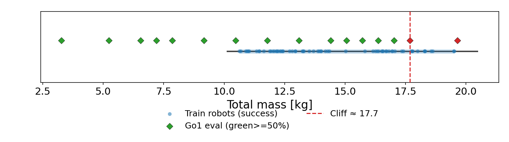

# DR narrow 履歴 Vintix の体スケール限界 — 実験レポート

> やったこと: narrow-DR 成功体の PPO 履歴で Vintix を学習し、Go1 の質量／大きさ／密度一定の 3 軸で評価した。
> これから: 同体学習（#18）他台・#11 wide/追加体・身体条件付けとの切り分け。

---

### 概要
narrow 100 体のうち報酬 ≥15 の **65 体**の履歴で Vintix を学習し、
Go1 体スケール 3 軸でゼロショット評価した（done=350 + skipped=120）。
学習に使った質量・脚長の範囲を数直線に示し、崖と対応付けた。

### 目的
形態 DR 由来の多様な履歴だけで学習した Vintix が、Go1 の質量・大きさ変化にどこまで耐えるか。
学習分布の外側／内側で崖がどう出るかを数直線で見る。

### 方法
- データ: `dr_robots_ppo_history` narrow GenLoco、成功体のみ（reward_last ≥ 15）
- 学習: `scripts/train_vintix.py`（epochs=5, context=2048, sparsity=128, group=`quadruped_locomotion`）
- 評価: #18 と同じ Go1 3 軸格子・10 seeds（Vintix のみ、early-stop）
- 可視化: 学習ロボットの質量・脚長数直線 ＋ 同体/LOO 比較図

### 実験内容・設定

| 項目 | 値 |
|------|-----|
| 成功体数 | 65 / 100 |
| 質量範囲 [kg] | 10.63 – 19.52 |
| 脚長範囲 [m] | 0.206 – 0.587 |
| 状態 | **評価完了**（2026-11-23 02:27） |
| Issue | [#21](https://github.com/ishiishiishii/vintix/issues/21) |

### 結果




| 軸 | 高側 0% 崖 | 注目点（10 seeds） | 対応する物理量（目安） |
|----|------------|-------------------|------------------------|
| mass | **1.5×** | 1.3× **57.7%**（LOO 同倍率 0%） | ≈19.6 kg で全滅；1.3×≈17.0 kg は学習帯内 |
| size | **1.35×** | 1.3× **34.1%**（LOO 5.8%） | thigh≈0.288 m（学習脚長帯の内側） |
| size_density | **1.1×** | 低側 0.5× **84%**（同体/LOO は 0%） | 高側は全手法同じ崖；低側だけ広げる |

同体（#18）・LOO（#10）との比較図:

- `figures/go1_mass_narrow_vs_samebody_loo_completion_mean_std_20261123.png`
- `figures/go1_size_narrow_vs_samebody_loo_completion_mean_std_20261123.png`
- `figures/go1_size_density_narrow_vs_samebody_loo_completion_mean_std_20261123.png`

### うまくいかなかったこと → 修正
- 初回評価に early-stop が無く遠方倍率を浪費しそうだった → #18 仕様を移植して付け替え再起動（2026-11-20）

### 考察・いま言えること
- **質量・大きさ:** 学習履歴の多様性は同体崖（1.15×）を越え、重い／大きい側で LOO より外側まで残る。
- **size_density 高側:** 多様性が帯を広げない（全手法 1.1× で 0%）。軸によって多様性効果が違う。
- **size_density 低側:** 同体が 0.8× で死ぬ帯でも narrow は 0.5–0.9× で高完走 → 低側では効く。
- **数直線:** 質量崖 ≈17.7 kg・脚長崖マーカーは学習分布の**内側**にも落ちる → カバレッジ拡張だけでは足りない可能性。

### 次の予定
- #16 立位レンダ（GPU）→ #22 MorFiC/GenLoco `--run` 実装
- #18 他台（Go2/A1/MC）同体評価、#11 narrow 追加シード／wide

<details>
<summary>詳細</summary>

#### データフィルタ
- CSV: `dr_robots_ppo_history/outputs/dr_narrow_expert_rewards.csv`
- 閾値: reward_last ≥ 15.0
- メタ: `configs/dr_narrow_success_meta.json`

#### 再現
```bash
cd /workspace/vintix_go2
bash dr_narrow_vintix_bodyscale/wait_and_run.sh
python dr_narrow_vintix_bodyscale/make_numberline_report.py
python dr_narrow_vintix_bodyscale/make_interim_mass_figure.py
python dr_narrow_vintix_bodyscale/make_interim_size_figure.py
python dr_narrow_vintix_bodyscale/make_interim_size_density_figure.py
```

</details>

---
Notion: https://app.notion.com/p/DR-narrow-Vintix-41cd65e6123f81d3b85ddb5c838740d0
