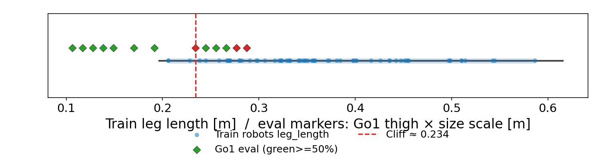

# DR narrow 履歴 Vintix の体スケール限界 — 実験レポート

> やったこと: narrow-DR 成功体の PPO 履歴で Vintix を学習し、Go1 の質量／大きさ／密度一定の 3 軸で評価する。
> これから: 数直線上で学習分布と崖を対応付け、同体学習（#18）・leave-one-out（#10）と比較する。

---

### 概要
narrow 100 体のうち報酬 ≥15 の **65 体**の履歴で Vintix を学習し、
Go1 体スケール 3 軸でゼロショット評価する。学習に使った質量・脚長の範囲を数直線に示し、
どこまで歩けてどこから無理かを対応付ける。

### 目的
形態 DR 由来の多様な履歴だけで学習した Vintix が、Go1 の質量・大きさ変化にどこまで耐えるか。
学習分布の外側／内側で崖がどう出るかを数直線で見る。

### 方法
- データ: `dr_robots_ppo_history` narrow GenLoco、成功体のみ（reward_last ≥ 15）
- 学習: `scripts/train_vintix.py`（epochs=5, context=2048, sparsity=128, group=`quadruped_locomotion`）
- 評価: #18 と同じ Go1 3 軸格子・10 seeds（Vintix のみ）
- 可視化: 学習ロボットの質量・脚長数直線 ＋ 評価 Success rate の対応

### 実験内容・設定

| 項目 | 値 |
|------|-----|
| 成功体数 | 65 / 100 |
| 質量範囲 [kg] | 10.63 – 19.52 |
| 脚長範囲 [m] | 0.206 – 0.587 |
| 状態 | 学習待ち／評価前 |
| Issue | [#21](https://github.com/ishiishiishii/vintix/issues/21) |

### 結果




評価結果はまだ無い（Go1 同体評価 #18 完了後に学習→評価）。

### うまくいかなかったこと → 修正
- （実行後に追記）

### 考察・いま言えること
- 学習分布（数直線の青帯）の内側でも Go1 評価が落ちるなら、分布カバレッジだけでは足りない。
- 分布の外で落ちるなら、まず範囲拡張（wide / 追加体）が次の一手。

### 次の予定
- #18 完了待ち → 本実験の学習・3 軸評価・数直線レポート更新
- 同体学習・leave-one-out との崖位置比較

<details>
<summary>詳細</summary>

#### データフィルタ
- CSV: `dr_robots_ppo_history/outputs/dr_narrow_expert_rewards.csv`
- 閾値: reward_last ≥ 15.0
- メタ: `configs/dr_narrow_success_meta.json`

#### 再現
```bash
cd /workspace/vintix_go2
bash dr_narrow_vintix_bodyscale/wait_and_run.sh   # #18 完了後に学習→評価→レポート
python dr_narrow_vintix_bodyscale/make_numberline_report.py
```

</details>

---
Notion: https://app.notion.com/p/DR-narrow-Vintix-41cd65e6123f81d3b85ddb5c838740d0
