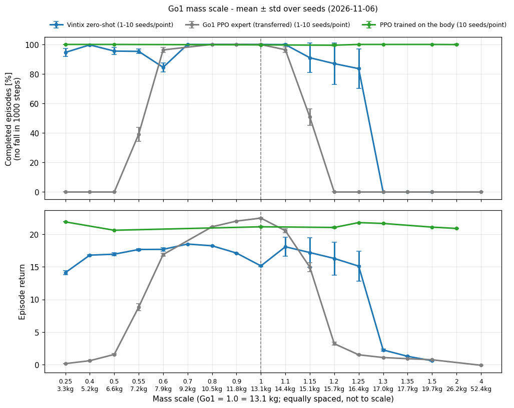
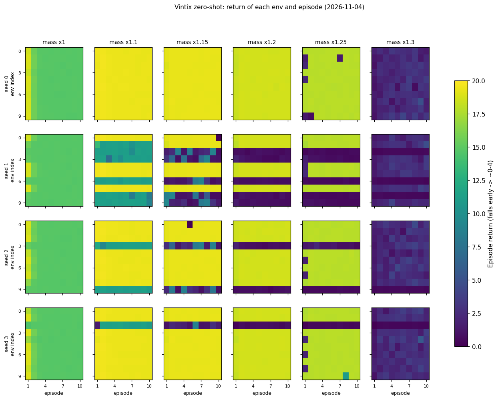
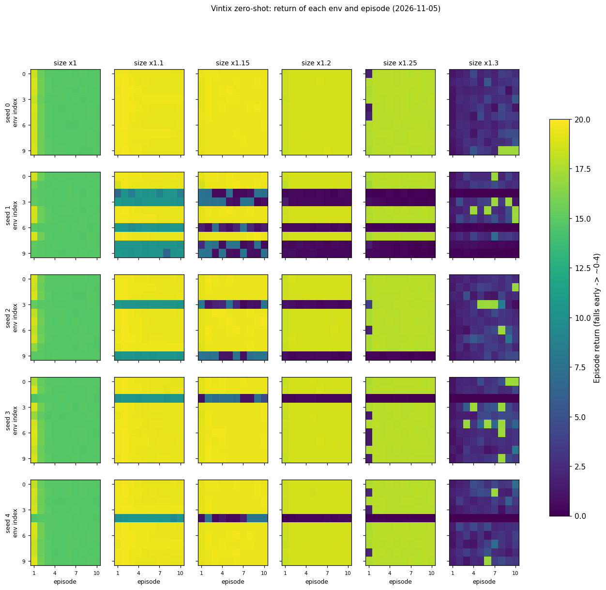
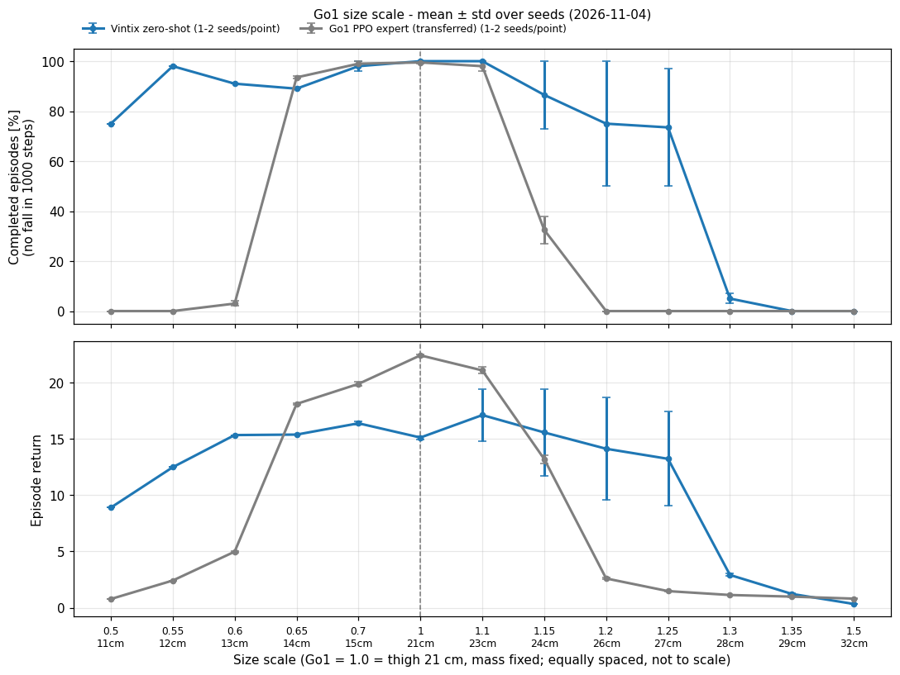
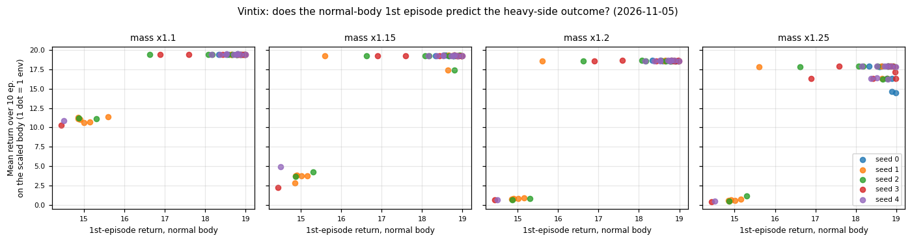
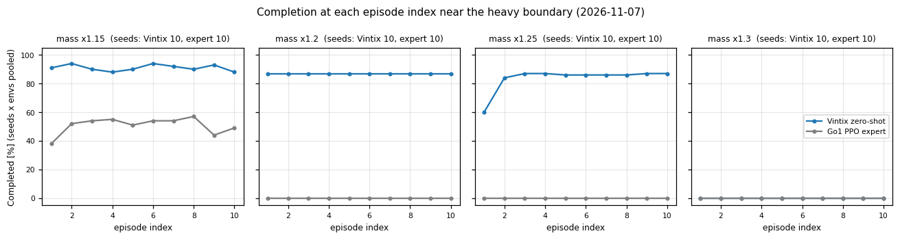
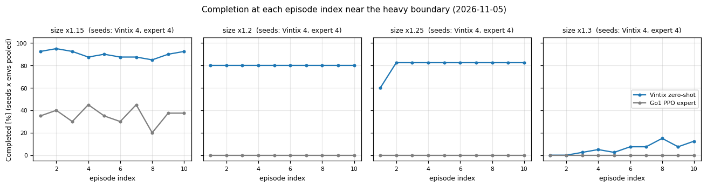
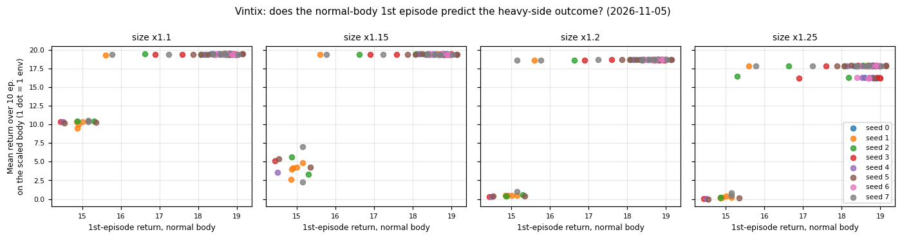

# go1_body_scale_zeroshot: Go1 の質量・大きさを変えたときのゼロショット性能

Go1 を基準に **質量だけ** / **大きさだけ** を段階的に変えた「改造 Go1」で、
Vintix のゼロショット（Go1 を学習していない `go1_without` を追加学習なしで使う）がどこまで歩けるかを調べる。
各倍率でエピソード報酬の平均と標準偏差を記録し、倍率を横軸にして並べる（成功／失敗の二値判定はしない）。

- 研究の目的: どれくらい体が違うとアルゴリズム蒸留（Vintix）だけではうまく適応できないかを調べる（`RESEARCH_OBJECTIVES.md`）
- 記録ページ（Notion）: [体の違いとゼロショット適応の限界](https://app.notion.com/p/40cd65e6123f81b3be04fe61479b7c70)（この目的の実験はすべてここに追記）
- 設計と議論: Notion「ISCIIA後のステップ」→「Go1 質量・サイズ変化のゼロショット境界（理解と設計書）」
- ブランチ: `exp/go1-body-scale-zeroshot`
- Issue: [#1](https://github.com/ishiishiishii/vintix/issues/1)（目的）、[#2](https://github.com/ishiishiishii/vintix/issues/2)（刻み・10 シード・PPO）、[#3](https://github.com/ishiishiishii/vintix/issues/3)（設計の合意）
- 区切りのまとめ: `REPORT.md`。経過は末尾の「実行ログ」

## 方針（Notion での合意）

| 項目 | 決定 |
|------|------|
| 質量の変え方 | 全リンクの質量と慣性を m 倍（体そのものが重い。寸法・重心位置は不変） |
| 大きさの変え方 | 全寸法を s 倍、**総質量は Go1 の 13.1 kg に固定**（慣性は s² 倍） |
| モデル | `models/go1_without/go1_without/0001_epoch`（ISCIIA のゼロショットと同じ） |
| 評価結果のまとめ方 | 倍率ごとの平均エピソード報酬 ± 標準偏差（二値判定なし） |
| PPO 専門家・AD データ作り | 本実験の範囲外（境界が分かった後、手が空いたら別途） |
| 既存コード | **変更しない**。この実験ディレクトリ内で既存クラスを継承・差し替えて使う |

## 固定するもの

制御器（kp=20、kd=0.5、行動スケール 0.25、既定関節角）、モータのトルク上限、報酬の重み、指令速度（前進 0.5 m/s）、
観測の正規化（既知 3 タスクの平均。`save_vintix.py` の未知タスク既定動作）は Go1 のまま。
大きさ軸だけ、初期高さ・報酬の目標高さ・足上げ高さを s 倍にする（大きい体が普通に立っているだけで罰されないように）。
ベースの設定は Go1 専門家の `Genesis/logs/go1-walking/cfgs.pkl`（初期高さ 0.40 m、目標高さ 0.32 m）。

## 掃引する倍率

| 軸 | 倍率 |
|----|------|
| 質量 m（Go1 13.1 kg 比） | 0.25, 0.4, 0.5, 0.6, 0.7, 0.8, 0.9, 1.0, 1.1, 1.2, 1.3, 1.5, 1.75, 2.0, 2.5, 3.0, 4.0 |
| 大きさ s（太もも 0.213 m 比） | 0.5, 0.6, 0.7, 0.8, 0.9, 1.0, 1.1, 1.2, 1.3, 1.4, 1.5, 1.75, 2.0 |

報酬が急に落ちる区間は `--mass_scales` / `--size_scales` で点を足して細かくする。

## 評価する方策

| 名前 | 中身 |
|------|------|
| `vintix` | `go1_without/0001_epoch` のゼロショット（`scripts/save_vintix.py` の評価関数） |
| `expert` | 通常の Go1 で学習した PPO 専門家 `model_2000.pt` をそのまま改造 Go1 に使う（`scripts/save_expert.py` の評価関数） |

評価条件はどちらも ISCIIA と同じ 10 環境 × 各 10 エピソード、1 エピソード最大 1000 step。

## ファイル

| ファイル | 役割 |
|----------|------|
| `scaled_go1_env.py` | 共通の `go1_env.Go1Env` を継承した `ScaledGo1Env`。URDF の読み込み倍率と、ビルド後のリンク質量を変える |
| `body_scale.py` | 倍率の格子と、`cfgs.pkl` から改造 Go1 用の設定を作る関数 |
| `run_experiment.py` | オーケストレーション。1 点ごとに子プロセスを起動し、共通の評価関数を呼ぶ。子プロセス内でだけ `save_vintix.Go1Env` / `save_expert.Go1Env` を `ScaledGo1Env` に差し替える（共通スクリプトのファイルは無変更） |
| `results/<policy>/<axis>/s<倍率>_r<反復>/` | 各点の評価出力（エピソード CSV、要約 txt、図） |
| `results/probe/<axis>/` | 体の確認（シミュレータ上の総質量、ゼロ行動で立たせたときの胴体高さ、画像） |
| `results.csv` / `summary.json` | 全点の集計 |
| `graphs/{mass,size}_scale_zeroshot.png` | 倍率 vs 報酬・エピソード長（平均 ± 標準偏差） |
| `logs/` | 各点の実行ログ |

## 第 2 段階: 刻みの追加・10 シード・PPO（`pipeline.py`）

| 項目 | 内容 |
|------|------|
| 追加の刻み | 質量 0.55, 1.15, 1.25, 1.35 / 大きさ 0.55, 0.65, 1.15, 1.25, 1.35（`body_scale.py` の `*_REFINE`） |
| シード | 0〜9。評価前に python / numpy / torch / Genesis を固定し、各シード 10 env × 10 ep（1 点 1000 エピソード）。同じシードで結果が完全一致することを確認済み |
| 順番 | ① 体の確認 → ② 境界付近（`BOUNDARY_GRID`）を全シード → ③ PPO を体ごとにゼロから学習（`PPO_GRID`、500 反復、学習シード 1）して 10 シード評価 → ④ 残りの点を全シード |
| 並列 | 評価は最大 4 本同時。PPO 学習は 1 本（評価 2 本分として数える）で、② が終わってから ④ と並行 |
| PPO 学習 | `run_experiment.py --worker train_ppo`。Go1 専門家の `cfgs.pkl` と同じ PPO 設定・`OnPolicyRunner`、4096 env、`precision=64`。出力 `ppo/<axis>/s<倍率>/` |
| 集計 | `results.csv`（シード付きの結果のみ。全エピソードの平均 ± 標準偏差と、シード平均のばらつき `reward_seed_std`）。以前の 1 回だけの結果は `results_single_run.csv` / `graphs/single_run/` に分けて残す |
| 進捗 | `pipeline_status.json`、`logs/pipeline.log`。`STOP` ファイルを置くと新しいジョブを起動しない |

```bash
cd /workspace/vintix_go2
setsid nohup python -u go1_body_scale_zeroshot/pipeline.py > go1_body_scale_zeroshot/logs/pipeline.log 2>&1 < /dev/null &
python go1_body_scale_zeroshot/pipeline.py --dry_run   # 段階ごとの完了数
```

## 実行方法（第 1 段階、コンテナ内）

```bash
cd /workspace/vintix_go2
# 体の確認（質量・立ち高さ・画像）
python go1_body_scale_zeroshot/run_experiment.py --stage probe
# 評価（完了済みの点は飛ばすので中断後に再開できる）
nohup python -u go1_body_scale_zeroshot/run_experiment.py --stage eval --policies expert,vintix \
    --report_every_point > go1_body_scale_zeroshot/logs/eval_all.log 2>&1 &
# 集計と図の作り直しだけ
python go1_body_scale_zeroshot/run_experiment.py --stage report
# 点を足す例
python go1_body_scale_zeroshot/run_experiment.py --stage eval --axes mass --mass_scales 1.15,1.25
```

倍率は 1.0 から外側へ交互に（1.0 → 0.9 → 1.1 → …）評価するので、途中で止めても両側の様子が分かる。

## 結果

最新の集計は `results.csv` と `graphs/`、まとめは `REPORT.md`。経過は下の「実行ログ」。

## 実行ログ

Notion の記録ページの「実行ログ」と同じ内容。新しいものが下。

### 2026-11-01〜11-02 第 1 段階: 各点 1 回の粗い掃引

- 実行内容: 質量 17 点・大きさ 13 点 ×（Vintix ゼロショット、Go1 専門家の流用）= 60 点、各 10 env × 10 ep を 1 回（シード未固定）
- 結果: Vintix は重い側・大きい側とも 1.2 倍で 100 エピソード中 90 回完走、1.3 倍で完走 0 回（質量）・17 回（大きさ）。
  軽い側は質量 0.25 倍でも報酬 14.5、小さい側は 0.5 倍で 8.9。流用した専門家は 1.2 倍で転倒、
  軽い側は 0.5 倍以下、小さい側は 0.6 倍以下で転倒（`results_single_run.csv`、`graphs/single_run/`）
- 考察: 軽い・小さい側は Vintix の方が明らかに広い。重い・大きい側は両方とも約 1.2 倍で崩れるが、
  PD ゲインとトルク上限を固定しているので「体そのものが歩けない」可能性があり、まだ切り分けられていない。各点 1 回だけなのでばらつきも未確認
- 次の実行内容: 境界の刻み追加、10 シード評価、PPO を各体でゼロから学習して歩けるかを確認

### 2026-11-04 第 2 段階を開始: 刻み追加・10 シード・PPO

- 実行内容: 質量 0.55/1.15/1.25/1.35、大きさ 0.55/0.65/1.15/1.25/1.35 を追加。境界付近 26 点を先にシード 0〜9
  （各 10 env × 10 ep、1 点 1000 エピソード）で評価し、終わったら PPO を 16 点でゼロから学習（500 反復）して 10 シード評価、
  並行して残りの点も 10 シード評価。`pipeline.py` で自動実行（評価 4 並列）
- 確認済み: 同じシードなら結果が完全一致、シードを変えると変わる。PPO 学習とその評価は小さな設定で通る
- 結果: 実行中（11-04 12:47 時点で境界付近 520 ジョブ中 2 完了、失敗 0）
- 次の実行内容: 境界付近のシード評価がそろい次第、平均 ± 標準偏差とシード間のばらつきを集計して追記する

### 2026-11-04 13:20 autopilot 監視: 第 2 段階の進み具合と所要時間の見積もり

- 実行内容: 新しいジョブは起動せず、`pipeline.py`（PID 1996884）を監視。GPU 使用率 100%（評価 4 本並列、16.5/24.5 GB）
- 結果: 体の確認 39/39 完了。境界付近は 520 ジョブ中 3 完了・4 実行中・失敗 0。
  完了したのは流用した専門家のシード 0 の 3 点で、質量 1.0 倍 22.29 ± 2.19（完走率 99%）、
  1.1 倍 20.24 ± 3.36（93%）、1.15 倍 15.14 ± 6.55（49%）。1.0・1.1 倍は第 1 段階の 1 回評価（22.28、19.79）とほぼ同じ（`results.csv`）
- 所要時間: Vintix の評価は 4 本並列だと 1 環境あたり約 2.6 step/秒で、最後まで歩ける点では 1 ジョブ約 65 分
  （専門家は 5〜7 分、すぐ転倒する点は 1 分前後）。境界付近だけで約 2〜2.5 日、PPO と残りの点を含めると全体で 3〜4 日かかる見込み
- 考察: 流用した専門家は質量 1.1〜1.2 倍の間で崩れ、1.15 倍で完走が約半分になる。ただしシード 1 つだけなので境界の位置はまだ言えない。
  Vintix のシード付きの結果はまだ無い
- 次の実行内容: 監視を続け、境界付近の Vintix の結果がそろったところで集計する（#2）。期間を縮めたい場合はシード数を減らすなどの判断が必要

### 2026-11-04 13:22 autopilot: 専門家の評価で 10 エピソードを超えて記録される件の確認

- 実行内容: 新しいジョブは起動せず監視のみ（前回から完了ジョブの増加なし、Vintix 4 本が 32〜45 分実行中、失敗 0）。
  前回気づいた `n_episodes` が 100 を超える点を、`results/*/*/*/go1_10envs_10episodes_episodes.csv` で環境ごとに数えて調べた
- 結果: 専門家（`save_expert.py` で評価）では、早く転倒した環境が上限の 10 を超えてエピソードを記録している
  （例: 質量 1.15 倍のシード 0 で 109 本、環境ごとに 10〜13 本。質量 3.0 倍の 1 回評価では 1 環境 65 本）。
  Vintix（`save_vintix.py`）の 30 点は、どの環境もちょうど 10 本で、この偏りは無い。
  - 平均報酬への影響は小さい: 各環境の先頭 10 本に絞ると、1.1 倍 20.24→20.38、1.15 倍 15.14→15.09、完走率は 93→94%、49→50%。
    すぐ転倒する点では大きめ（質量 3.0 倍 −0.26→−0.87、大きさ 0.6 倍 5.31→5.57）
  - `reward_last_episode_mean` は信頼できない: 全環境で最大の `episode_number` を持つエピソードだけを平均しているため、
    超過した 1〜6 本だけの値になる（例: 質量 1.1 倍のシード 0 の 6.72 は 330 step で転倒した 1 本だけで、各環境の 10 本目の平均なら 20.05。
    1.15 倍は 10.06 対 16.62。1 回評価の大きさ 0.6 倍は 0.69 対 7.73）
- 考察: 専門家の平均報酬・完走率の結論（1.1〜1.2 倍で崩れる）は変わらない。一方、専門家の「最初と最後のエピソードの比較」は
  今の集計では使えない。Vintix の文脈内での上達（最初と最後の比較）は今のところ偏りなく測れている
- 次の実行内容: `run_experiment.py` の `collect_rows` を「各環境の先頭 `max_episodes` 本に絞り、最初・最後は各環境の 1 本目・10 本目で取る」
  形に直す。ただし稼働中の `pipeline.py` は起動時に `run_experiment` を読み込み済みで、自動集計が古いロジックで `results.csv` を上書きし続けるため、
  パイプラインの完了後（または再起動の機会）に直して `--stage report` で再集計する。生データは残っているので再集計で足りる（#2）

### 2026-11-04 15:30 autopilot: 質量軸の境界付近のシード 0 がそろった

- 実行内容: 新しいジョブは起動せず監視のみ（GPU 100%、評価 4 本並列、失敗 0）。境界付近は 520 ジョブ中 27 完了（前回 3）。
  質量軸の境界付近 12 点で Vintix と流用専門家のシード 0 が出そろったので（Vintix の 0.25 倍だけ実行中）、
  `results.csv` を第 1 段階と比べ、生データ（`results/vintix/mass/*_seed0/go1_10envs_10episodes_episodes.csv`）でエピソードごとの推移を見た。
  いまは大きさ軸のシード 0（1.0/1.1/1.15 倍）を評価中
- 結果（シード 0、各点 10 env × 10 ep。速度指令は 0.5 m/s 固定。専門家の前進速度は評価スクリプトが出さない）:

  | 質量倍率 | Vintix 報酬 | Vintix 完走率 | Vintix 前進速度 m/s | 専門家 報酬 | 専門家 完走率 |
  |---|---|---|---|---|---|
  | 0.4 | 16.85 | 100% | 0.54 | 0.56 | 0% |
  | 0.5 | 16.99 | 95% | 0.46 | 1.57 | 0% |
  | 0.55 | 17.42 | 92% | 0.45 | 7.86 | 35% |
  | 0.6 | 17.49 | 82% | 0.42 | 17.11 | 98% |
  | 1.0 | 15.24 | 100% | 0.40 | 22.29 | 99% |
  | 1.1 | 19.44 | 100% | 0.39 | 20.24 | 93% |
  | 1.15 | 19.29 | 100% | 0.38 | 15.14 | 49% |
  | 1.2 | 18.62 | 100% | 0.36 | 3.33 | 0% |
  | 1.25 | 16.90 | 94% | 0.35 | 1.49 | 0% |
  | 1.3 | 2.37 | 0% | 0.35 | 1.12 | 0% |
  | 1.35 | 1.37 | 0% | 0.34 | 0.94 | 0% |
  | 1.5 | 0.62 | 0% | 0.33 | 0.77 | 0% |

  - Vintix のエピソードごとの推移（10 env の平均、1 本目 → 3 本目 → 10 本目）: 1.25 倍 11.4 → 17.9 → 17.9
    （1 本目は環境によって 1.3〜17.8 とばらつき、3 本目以降は全環境が 17.8〜18.0）。1.3 倍 1.3 → 2.3 → 2.4（上がるが転倒したまま）。
    1.0 倍 18.8 → 14.8 → 14.7（下がってから一定）
  - ばらつき: 1 回の評価の中では 10 env がほぼ同じ動きに収束し、標準偏差は 0.04〜0.1 程度（1.1・1.15・1.2 倍）。
    一方、第 1 段階（シード未固定）とシード 0 の差は 1.1 倍 17.74 対 19.44、1.2 倍 16.86 対 18.62 と約 1.7 ある
  - 図: `graphs/mass_scale_zeroshot.png`（自動集計で更新済み）
- 考察:
  - 言えること: 質量軸の重い側の境界は、専門家が 1.15〜1.2 倍、Vintix が 1.25〜1.3 倍で、Vintix の方が約 0.1 倍広い。
    第 1 段階で「両方とも約 1.2 倍で崩れる」と見えたのは、1.2 の次が 1.3 だったため。完走率の切り替わり（Vintix 94% → 0%、専門家 49% → 0%）は
    はっきりしていて、第 1 段階の結果とも矛盾しない。軽い側も Vintix は 0.4 倍で完走 100%、専門家は 0.55 倍で 35%、0.5 倍で 0%
  - 1.25 倍では 1 本目に転ぶ環境があっても 3 本目までに全環境が完走する。文脈内で適応している兆し。1.3 倍では報酬は上がるが転倒は避けられない
  - ただし Vintix は「完走」しても指令の 0.5 m/s より遅い（1.0 倍 0.40 → 1.25 倍 0.35 m/s、±15% に入る割合は 37% → 1%）。
    重くなるほど遅く歩いて転倒を避けている可能性がある。完走率だけでなく速度も合わせて見る必要がある
  - まだ言えないこと: シードが 1 つなので、報酬の 2 程度の差（例: 1.1 倍で Vintix 19.4 対 専門家 20.2）は、実行ごとの差（約 1.7）と区別できない。
    1 回の評価の中の標準偏差は env が同じ動きに収束するため小さく出て、不確かさを過小評価する。境界の判断は 10 シードを待つ。
    1.3 倍で崩れるのが Vintix の限界か、PD ゲインとトルク上限を固定した体そのものの限界かは、③ の PPO（体ごとにゼロから学習）の結果待ち
  - 気になる点: 通常の体（1.0 倍）で Vintix の報酬が 1 本目 18.8 から 14.7 に下がって一定になる（第 1 段階 15.14、ISCIIA の Go1 ゼロショット 15.17 と同じ）。
    1.1〜1.2 倍（約 19）より低い。原因は未調査
- 次の実行内容: 監視を続ける。大きさ軸のシード 0 がそろったら同じ集計をする。シード 1〜9 がそろったら境界を平均 ± シード間の標準偏差で確定させる。
  `collect_rows` の修正は前回のとおりパイプライン完了後（#2）

### 2026-11-04 17:40 autopilot: 大きさ軸のシード 0 がほぼそろい、両軸で境界が同じ倍率に出た

- 実行内容: 新しいジョブは起動せず監視のみ（GPU 100%、評価 4 本並列、失敗 0）。境界付近は 520 ジョブ中 50 完了（前回 27）。
  大きさ軸の境界付近で専門家 13 点・Vintix 11 点のシード 0 がそろった（Vintix の 0.5・0.55 倍は実行中）。いまはシード 1（質量 1.0 倍）に進んでいる。
  `results.csv` に加え、生データで各環境の先頭 10 本に絞ったエピソードごとの推移と、体の確認（`results/probe/*/*.json`、ゼロ行動で既定姿勢を保たせたときの 10 環境中の転倒数）を見た
- 結果（大きさ軸、シード 0、各点 10 env × 10 ep、質量は 13.1 kg 固定）:

  | 大きさ倍率 | Vintix 報酬 | Vintix 完走率 | Vintix 前進速度 m/s | 専門家 報酬 | 専門家 完走率 | ゼロ行動での転倒（10 env 中） |
  |---|---|---|---|---|---|---|
  | 0.5 | 実行中 | | | 0.78 | 0% | 0 |
  | 0.55 | 実行中 | | | 2.26 | 0% | 0 |
  | 0.6 | 15.32 | 91% | 0.27 | 5.35 | 2% | 0 |
  | 0.65 | 15.36 | 89% | 0.27 | 18.02 | 93% | 0 |
  | 0.7 | 16.22 | 96% | 0.28 | 19.67 | 98% | 0 |
  | 1.0 | 15.24 | 100% | 0.40 | 22.29 | 99% | 0 |
  | 1.1 | 19.42 | 100% | 0.42 | 20.78 | 96% | 0 |
  | 1.15 | 19.41 | 100% | 0.43 | 13.07 | 35% | 2 |
  | 1.2 | 18.67 | 100% | 0.42 | 2.71 | 0% | 3 |
  | 1.25 | 17.39 | 97% | 0.42 | 1.51 | 0% | 3 |
  | 1.3 | 3.02 | 3% | 0.43 | 1.15 | 0% | 4 |
  | 1.35 | 1.32 | 0% | 0.41 | 1.01 | 0% | 6 |
  | 1.5 | 0.34 | 0% | 0.38 | 0.82 | 0% | 7 |

  - 質量軸のゼロ行動での転倒は 1.15 倍で 0、1.2 倍で 2、1.25〜1.35 倍で 4、1.5 倍で 7（10 env 中）
  - Vintix のエピソードごとの推移（10 env 平均、1 本目 → 3 本目 → 10 本目、カッコは完走率）: 1.25 倍 12.8（70%）→ 17.9 → 17.9（100%）、
    1.3 倍 1.2（0%）→ 2.3 → 4.9（10%）、0.7 倍 13.8（60%）→ 16.5 → 16.5（100%）。1.0 倍は質量軸と同じ体で、18.8 → 14.8 → 14.7 と同じ値（シード固定で再現）
  - 専門家（各環境の先頭 10 本）: 1.15 倍 15.1（60%）→ 14.9 → 13.8（40%）、0.6 倍 8.0（10%）→ 5.1 → 3.4（0%）。専門家は回を重ねても良くならない
  - 図: `graphs/size_scale_zeroshot.png`（自動集計で更新済み）
- 考察:
  - 言えること（シード 0）: 大きい側の境界は専門家 1.1〜1.2 倍（96% → 35% → 0%）、Vintix 1.25〜1.3 倍（97% → 3%）で、**質量軸と同じ倍率**に出た。
    Vintix の方が約 0.1 倍広い点も同じ。小さい側は専門家が 0.6〜0.65 倍で崩れ（2% → 93%）、Vintix は 0.6 倍でも完走 91%
  - 両軸の境界が一致する理由の仮説: 既定姿勢を保つのに関節が出すべき重力トルクは「質量 × 脚の長さ」に比例するので、質量 m 倍と大きさ s 倍は
    同じ倍率で負荷を増やす。PD ゲイン（kp=20）とトルク上限を固定しているため、同じ倍率で姿勢が沈む・トルクが足りなくなる。
    ゼロ行動での転倒が両軸ともほぼ同じ倍率（質量 1.2 倍、大きさ 1.15 倍）から出始め、専門家の崩れる倍率と重なることもこれと合う。
    Vintix は行動（目標角度のずらし）で補って約 0.1 倍先まで持ちこたえていると読める。ただしこれは推測で、検証していない
  - 注意: Vintix は小さい体で完走しても前進速度が 0.27 m/s と指令 0.5 m/s の約半分（±15% に入る割合はほぼ 0%）。
    脚が短く歩幅が小さいためと考えられるが、「完走 = 適応できた」とは言えない。専門家の速度は評価スクリプトが出さないので比べられない
  - まだ言えないこと: シード 1 つ。仮説（質量 × 脚の長さで決まる）は両軸の一致から立てただけで、質量と大きさを同時に変えた体で確かめる必要がある。
    1.3 倍で崩れるのが体そのものの限界かは PPO を体ごとに学習した結果待ち
- 次の実行内容: 監視を続ける。Vintix 大きさ 0.5・0.55 倍のシード 0 が出たら小さい側の境界を追記する。
  仮説の検証（質量と大きさを同時に変える）は #2 の範囲外なので #7 に切り出し、実行するか・いつやるかの判断を求めている（#2、#7）

### 2026-11-04 19:40 質量 1.15〜1.25 倍の Vintix はシードで完走率が 48〜100% と大きくぶれる



- 実行内容: 質量軸のシード 1 が出たので、各環境の先頭 10 本でシードごとに集計し、図を作り直した（`make_figures.py`）。
  Notion の記録ページを「結論 → 図 → 要点 → 詳細はトグル」の構成に書き換えた
- 結果: Vintix の完走率（シード 0 / 1）は 1.15 倍 100% / 65%、1.2 倍 100% / 50%、1.25 倍 94% / 48%、1.3 倍 0% / 0%。
  シード 1 は 1.15〜1.25 倍で一貫して悪い。流用した専門家は 1.15 倍 50% / 61%、1.2 倍 0% / 0% と安定
- 考察: 境界付近では Vintix の振る舞いが評価ごとに大きく変わる。「Vintix は約 0.1 倍広い」はシード 10 個の平均とばらつきで確かめる必要がある
  （それでもシード 1 の 1.2 倍で 50% 完走しており、専門家の 0% よりは歩けている）
- 次: シード 2〜9 を待って境界を確定（#2）

### 2026-11-04 19:45 autopilot: 境界付近の Vintix は環境ごとに「ずっと歩ける／ずっと転ぶ」に分かれ、同じシードなら同じ環境が同じ側に入る



- 実行内容: 新しいジョブは起動せず監視のみ（GPU 100%、評価 4 本並列、失敗 0、境界付近 75/520）。前回のシードごとのぶれの中身を見るため、
  質量軸の Vintix を環境 × エピソードの報酬で並べる図を `make_figures.py` に追加した（`plot_env_modes`）。評価の乱数がどこに入るかをコードで確認した
- 結果（質量軸、シード 0 / 1、各 10 env × 10 ep）:

  | 質量倍率 | シード 0: 歩ける環境 | シード 1: 歩ける環境（番号） | シード 1 の低い側の報酬 |
  |---|---|---|---|
  | 1.0 | 10/10（1 本目 18.8 → 2 本目以降は全環境 14.8） | 10/10（同じく全環境 14.8 にそろう） | |
  | 1.1 | 10/10（19.4） | 4/10（0, 4, 5, 7 が 19.4） | 約 11（完走はする） |
  | 1.15 | 10/10（19.3） | 5/10（0, 1, 4, 5, 7） | 3〜4（転ぶ） |
  | 1.2 | 10/10（18.6） | 5/10（同じ 5 環境） | 0.7（転ぶ） |
  | 1.25 | 10/10（1 本目に転んだ 4 環境も 2 本目から 17.9） | 5/10（同じ 5 環境） | 0.5（転ぶ） |
  | 1.3 | 0/10 | 0/10 | |

  - 軽い側（0.55・0.6 倍）はシード 1 も出て、Vintix はシード 0 / 1 で完走 92% / 93%、82% / 87% とほぼ同じ。ぶれは重い側の境界付近だけ
  - コードで確認: Vintix の評価で各環境に入る乱数は評価開始時の初期のずれ（位置 ±10 cm、ロール・ピッチ ±5°、関節角 ±0.1 rad、`scripts/save_vintix.py` 350〜365 行）だけ。
    2 本目以降のリセットはずれのない既定姿勢（`go1_env.py` の `reset_idx`）で、行動の決定にも乱数は無い
- 考察:
  - 言えること: シードによるぶれの正体は、環境ごとの二極化（10 本を通して歩ける側か転ぶ側に固定）。シード 1 では 1.15〜1.25 倍で同じ 5 環境が転び続ける。
    低い側の環境は 1.15 倍から転び、流用した専門家の崩れる倍率（1.15〜1.2 倍）とほぼ同じ。「Vintix の方が約 0.1 倍広い」のは、歩ける側に入った環境の話
  - 解釈（推測）: シード固定で torch の乱数列が同じなので、同じ環境番号には倍率によらず同じ初期のずれが入る。1 本目の動きが履歴（文脈 2048 step ≈ 2 エピソード分）に残り、
    その後の歩き方を固定している可能性。悪い側に入った環境は 10 本の間に抜け出せていない（文脈内適応の限界の 1 つの形）
  - 集計の注意: 各環境の 10 本は独立な試行ではない。完走率の信頼区間は「シード × 環境」（10 シードで 100 個）を単位に考えるべき
  - まだ言えないこと: 初期のずれのどの成分が効いているか、文脈を消すと二極化が消えるか。シード 2 つでは「歩ける側に入る割合」は推定できない
- 次の実行内容: #2 のシード 0〜9 がそろったら、倍率ごとに歩ける側に入った環境の割合を集計する。初期のずれの記録と文脈を切る対照評価は #8 に切り出し、判断を求めている（約 10 GPU 時間）

### 2026-11-04 21:50 autopilot: 大きさ軸でもシード 1 は質量軸と同じ 5 環境（2, 3, 6, 8, 9）が転ぶ側に入る





- 実行内容: 新しいジョブは起動せず監視のみ（GPU 100%、評価 4 本並列、失敗 0、境界付近 98/520）。大きさ軸のシード 1 が
  重い側（1.0〜1.5 倍）と小さい側の専門家（0.6〜0.7 倍）、Vintix 0.7 倍まで出たので、各環境の先頭 10 本で集計し、
  前回の環境 × エピソードの図を大きさ軸でも描いた（`make_figures.py` に 1 行追加）
- 結果（大きさ軸、シード 0 / 1、各 10 env × 10 ep。環境ごとの値は 2〜10 本目の平均報酬）:

  | 大きさ倍率 | Vintix 完走率 | Vintix シード 1 の歩ける環境（約 18〜19） | シード 1 の低い側 | 専門家 完走率 |
  |---|---|---|---|---|
  | 1.0 | 100% / 100% | 全環境 14.8 にそろう（質量軸と同じ体なので完全一致） | | 99% / 100% |
  | 1.1 | 100% / 100% | 0, 1, 4, 5, 7（質量軸は 0, 4, 5, 7） | 2, 3, 6, 8, 9 が約 10（完走はする） | 96% / 100% |
  | 1.15 | 100% / 73% | 0, 1, 4, 5, 7 | 2, 3, 6, 8, 9 が 3〜5（転ぶか、ほぼ進まず 1000 step 耐える） | 38% / 27% |
  | 1.2 | 100% / 50% | 0, 1, 4, 5, 7 | 2, 3, 6, 8, 9 が 0.4（毎回転ぶ） | 0% / 0% |
  | 1.25 | 97% / 50% | 0, 1, 4, 5, 7 | 2, 3, 6, 8, 9 が 0.2（毎回転ぶ） | 0% / 0% |
  | 1.3 | 3% / 7% | なし | | 0% / 0% |

  - 質量軸のシード 1 も 1.15〜1.25 倍で転ぶ側は 2, 3, 6, 8, 9 で、**軸が違っても同じ環境番号**が同じ側に入った
  - 通常体（1.0 倍）のシード 1 でも、1 本目の報酬は 0, 4, 5, 7 番が 18.6〜18.9、ほかは 14.9〜15.6 と同じ分かれ方をしている（2 本目以降は全環境 14.8）
  - 小さい側: 専門家は 0.6 倍で完走 2% / 4%、0.65 倍で 94% / 93% とシードによらず同じ。Vintix は 0.7 倍で 96% / 100%（0.55〜0.65 倍のシード 1 は実行中）
  - 専門家の大きい側 1.15 倍は 38% / 27% で、質量軸の 1.15 倍（50% / 61%）より少し早く崩れる
- 考察:
  - 言えること: 環境ごとの二極化は質量軸だけの現象ではなく、大きさ軸でも同じシード・同じ環境番号で起きる。
    評価で環境ごとに入る乱数は開始時の初期のずれ（`save_vintix.py` 350〜365 行）だけなので、同じシードなら軸によらず同じ環境に同じずれが入る。
    「どの環境が転ぶ側に入るかは体ではなく 1 本目の初期のずれで決まる」という #8 の仮説を支持する（ただし初期のずれを直接記録・操作した検証ではない）
  - 歩ける側の環境だけを見れば、Vintix は両軸とも 1.25 倍まで歩け、専門家（1.15〜1.2 倍で崩れる）より約 0.1 倍広い。
    転ぶ側の環境は専門家とほぼ同じ 1.15 倍から崩れる
  - まだ言えないこと: シード 2 個・環境 20 個では、倍率ごとに歩ける側に入る割合は推定できない。初期のずれのどの成分（位置・傾き・関節角）が効いているかも未確認
- 次の実行内容: 監視を続け、シード 2〜9 がそろったら倍率ごとに「歩ける側に入った環境の割合」を集計する（#2）。
  今回の結果は #8（初期のずれの記録と文脈を切る対照評価、約 10 GPU 時間）の動機を強めるので #8 に追記し、引き続き判断を求める

### 2026-11-04 23:55 autopilot: 重い体で転ぶ環境は、通常体の 1 本目の報酬（約 15 か約 18.5 か）で見分けられる（シード 0〜2）




- 実行内容: 新しいジョブは起動せず監視のみ（GPU 100%、評価 4 本並列、失敗 0、境界付近 123/520、約 12 ジョブ/時）。
  質量軸のシード 2 が重い側（Vintix 1.0〜1.5 倍、専門家 0.5〜1.5 倍）まで、大きさ軸のシード 1 が小さい側（0.5〜0.7 倍）まで出たので、
  各環境の先頭 10 本で集計した。`make_figures.py` に `plot_first_episode_vs_heavy`（通常体の 1 本目と重い体の結果の散布図）を追加
- 結果（質量軸、シード 0 / 1 / 2、各 10 env × 10 ep）:

  | 質量倍率 | Vintix 完走率 | 転ぶ側（低い側）の環境 シード 0 / 1 / 2 | 専門家 完走率 |
  |---|---|---|---|
  | 1.0 | 100 / 100 / 100% | なし（全環境 2 本目から 14.8） | 99 / 100 / 100% |
  | 1.1 | 100 / 100 / 100% | なし / 1, 2, 3, 6, 8, 9（約 11、完走） / 3, 9（約 11、完走） | 94 / 96 / 99% |
  | 1.15 | 100 / 65 / 86% | なし / 2, 3, 6, 8, 9 / 3, 9 | 50 / 61 / 54% |
  | 1.2 | 100 / 50 / 80% | なし / 2, 3, 6, 8, 9 / 3, 9（0.7〜0.8、毎回転ぶ） | 0 / 0 / 0% |
  | 1.25 | 94 / 48 / 78% | （1, 9 が少し低い） / 2, 3, 6, 8, 9 / 3, 9 | 0 / 0 / 0% |
  | 1.3 | 0 / 0 / 0% | 全環境 | 0 / 0 / 0% |

  - シード平均 ± シード間の標準偏差（Vintix 報酬）: 1.1 倍 17.2 ± 2.1、1.15 倍 15.5 ± 3.3、1.2 倍 14.5 ± 3.7、1.25 倍 13.3 ± 3.3。専門家は 1.15 倍 15.0 ± 0.1 とシードでほとんど動かない
  - **通常体（1.0 倍）の 1 本目の報酬**: シード 2 は 3 番 15.3、9 番 14.9、8 番 16.6、ほか 18.1〜18.9。シード 1 は 1, 2, 3, 6, 8, 9 番が 14.9〜15.6、ほか 18.6〜18.9。シード 0 は全環境 18.3〜19.0
  - 1 本目が 15.5 未満だった 7 環境（シード 1 の 2, 3, 6, 8, 9、シード 2 の 3, 9）は質量 1.2 倍で 7 個とも転ぶ側、15.5 以上の 23 環境は 23 個とも歩ける側（30 個中 30 個一致）。
    中間の 2 環境（シード 1 の 1 番 15.6、シード 2 の 8 番 16.6）は 1.1 倍では低い側か境目だが、1.15 倍以上では歩ける側。大きさ軸 1.2 倍（シード 0・1）でも 20 個中 20 個一致
  - 大きさ軸の小さい側（シード 0 / 1）: Vintix 完走率 0.5 倍 75 / 74%、0.55 倍 98 / 99%、0.6 倍 91 / 86%、0.7 倍 96 / 100%。
    ただし前進速度は 0.16〜0.28 m/s（指令 0.5 m/s）、指令の ±15% 以内に入る割合はほぼ 0% で、倒れずに耐えているだけに近い。専門家は 0.6 倍 2 / 4%、0.65 倍 94 / 93%
  - 専門家は質量軸でもシード間でほぼ同じ（1.15 倍 50 / 61 / 54%、軽い側 0.55 倍 38 / 40 / 48%、0.6 倍 98 / 95 / 96%）
- 考察:
  - 言えること: 3 シードとも、同じシードの中では倍率・軸によらず同じ環境が転ぶ側に入る。転ぶ側の環境は、通常体の 1 本目ですでに報酬約 15 の「低い歩き方」になっている。
    通常体で 1 本目に低い歩き方に入った環境は、体が重くなるとそのまま転ぶ、と読める。#8 の「1 本目の初期のずれが歩き方を決める」という仮説と矛盾しない
  - 転ぶ側に入る環境の数はシードで 0 / 5 / 2 個とばらつく（30 個中 7 個、23%）。Vintix のシード間のばらつき（報酬で約 3.3）は、ほぼこの個数の違いで説明できる
  - まだ言えないこと: 閾値 15.5 は結果を見てから決めたもので、転ぶ側は 7 個しかない。通常体での 1 本目の差が初期のずれのどの成分から来るか、文脈を切れば二極化が消えるかは確かめていない（#8 の評価が必要）。
    小さい側の Vintix の完走率は速度が出ていないので、歩けている証拠にはならない
- 次の実行内容: 監視を続ける。シード 3 以降で「通常体の 1 本目 < 15.5 → 重い体で転ぶ」が当たり続けるかを確かめる（事前に決めた閾値として扱う）。
  境界付近の残りは約 400 ジョブで約 33 時間の見込み。#7・#8 はユーザーの判断待ち

### 2026-11-05 02:00 autopilot: 事前に決めた「通常体の 1 本目 < 15.5 → 重い体で転ぶ」が大きさ軸シード 2 の 10 環境すべてで当たった
- 状況: `pipeline.py`（PID 1996884）は稼働中、失敗 0。境界付近 146/520（前回 123、約 11 ジョブ/時）、PPO 0/176、残り 1/260。GPU 100%（評価 4 本並列）
- 新しい結果: 大きさ軸のシード 2（Vintix 1.0〜1.5 倍、1.25 倍は実行中。専門家 0.7〜1.5 倍）と質量軸の軽い側のシード 2（Vintix・専門家 0.5〜0.6 倍）

  | 大きさ倍率 | Vintix 完走率 シード 0 / 1 / 2 | 転ぶ側（低い側）の環境 シード 2 | 専門家 完走率 シード 0 / 1 / 2 |
  |---|---|---|---|
  | 1.1 | 100 / 100 / 100% | 3, 9（約 10.5、完走） | 96 / 100 / 98% |
  | 1.15 | 100 / 73 / 90% | 3, 9（3.3、5.6） | 38 / 27 / 37% |
  | 1.2 | 100 / 50 / 80% | 3, 9（0.4〜0.5、毎回転ぶ） | 0 / 0 / 0% |
  | 1.25 | 97 / 50 / 実行中 | – | 0 / 0 / 0% |
  | 1.3 | 3 / 7 / 5% | 全環境 | 0 / 0 / 0% |

  - 前回（23:55）事前に決めた予測: シード 2 の通常体の 1 本目が 15.5 未満なのは 3 番（15.3）と 9 番（14.9）→ この 2 環境だけが重い側で転ぶ。
    大きさ 1.15・1.2 倍で転んだのはちょうど 3 番と 9 番、ほかの 8 環境は報酬 18.6〜19.4 で歩ける側（10 個中 10 個一致）。図: `figures/vintix_size_first_episode_predictor_20261104.png`、`figures/vintix_size_env_modes_20261104.png`
  - 大きさ軸 1.2 倍のシード 0〜2 を合わせると 30 個中 30 個一致（うち 10 個が結果を見る前に決めた閾値での判定）。質量軸のシード 2 と大きさ軸のシード 2 で転ぶ環境番号も同じ
  - 1.3 倍ではシードによらず全環境が転ぶ（完走 3 / 7 / 5%）。歩ける側の環境の上限は 1.25〜1.3 倍、転ぶ側の環境は 1.15 倍で崩れ始め、専門家（1.15〜1.2 倍）とほぼ同じ
  - 質量軸の軽い側（3 シード平均）: Vintix 完走率 0.5 倍 96%、0.55 倍 94%、0.6 倍 86%、前進速度 0.46 / 0.45 / 0.42 m/s、指令 ±15% 以内 50 / 48 / 45%。
    大きさ軸の小さい側（速度 0.16〜0.28 m/s、追従ほぼ 0%）と違い、軽い体では指令に近い速さで歩けている。専門家はシード 2 で 0.5 倍 0%、0.55 倍 48%、0.6 倍 96%
- 考察:
  - 言えること: 結果を見る前に決めた閾値で、初めて予測として当たった。3 シード × 2 軸で「同じシードなら軸・倍率によらず同じ環境が転び、それは通常体の 1 本目ですでに低い歩き方（報酬約 15）に入った環境」という形がそろった。
    Vintix が専門家より重い側まで歩けるのは、1 本目に高い歩き方（約 18.5）に入った環境だけ。低い歩き方に入った環境の限界は専門家とほぼ同じ 1.15 倍
  - まだ言えないこと: 予測の検証は転ぶ側 2 個・歩ける側 8 個と小さい。なぜ 1 本目で低い歩き方に入るか（初期のずれのどの成分か）と、文脈を切れば二極化が消えるかは未検証（#8 の評価が必要）
- 次の実行内容: 監視を続ける。シード 3 以降でも同じ閾値で予測が当たるかを確かめる。境界付近の残り約 374 ジョブで約 33 時間の見込み。#7・#8 はユーザーの判断待ち

### 2026-11-05 04:00 autopilot: シード 3 の事前予測（重い側の結果が出る前に記録）
- 状況: `pipeline.py`（PID 1996884）は稼働中、失敗 0。境界付近 163/520（前回 146）、PPO 0/176、残り 1/260。GPU 100%（Vintix 質量 1.15・1.2・1.25・1.3 倍シード 3 を評価中）
- 予測の根拠（質量 1.0 倍シード 3 の Vintix、各環境の 1 本目の報酬）: 0 番 17.6、1 番 18.9、**2 番 14.4**、3 番 19.0、4 番 16.9、5 番 18.8、6 番 19.0、7 番 18.9、8 番 18.4、9 番 19.0。2 本目以降は全環境 14.7〜15.8 にそろう（完走 100%、平均 15.16）
- **予測（閾値 15.5、23:55 に決めたもの）**: シード 3 で重い側（質量 1.15〜1.25 倍、大きさ 1.15〜1.25 倍）に転ぶ側に入るのは 2 番だけ。ほかの 9 環境は歩ける側（4 番は 16.9 で中間だが、これまでの中間 2 例は 1.15 倍以上で歩ける側だった）。
  したがって Vintix の完走率は質量 1.15〜1.2 倍で約 90%（1.25 倍は歩ける側でも少し落ちることがあるので 80〜90%）、1.3 倍は全環境が転ぶ
- 予測前に出ていた点（予測の検証には数えない）: 質量 1.1 倍シード 3 では 2 番だけが低い側（1 本目は 200 step で転倒、2 本目以降は報酬約 11 で完走）、ほか 9 環境は 19.2〜19.6。完走 99%、平均 18.51
- 専門家シード 3（質量）: 完走率 1.0 倍 100%、1.1 倍 97%、1.15 倍 52%、1.2 倍 0%、1.25 倍 0%（シード 0〜2 と同じ）

### 2026-11-05 04:20 autopilot: 質量軸シード 3 でも事前予測どおり 2 番だけが重い側で転んだ（予測の検証は 2 シード 20 環境で 20/20）


- 実行内容: 新しいジョブは起動せず監視のみ（GPU 100%、評価 4 本並列、失敗 0、境界付近 172/520、PPO 0/176、残り 1/260）。
  04:00 の予測を書いてコミット（a5341c3）・push した後に出た質量 1.15・1.2・1.3 倍シード 3 と照合した。図を更新
- 結果（質量軸シード 3、各 10 env × 10 ep）:

  | 質量倍率 | 予測 | Vintix 結果 | 専門家 完走率 |
  |---|---|---|---|
  | 1.15 | 2 番だけ転ぶ、完走約 90% | 2 番だけ転ぶ（10 本中 9 本、報酬 0.9〜8.9）、ほか 9 環境は 19.2〜19.4 で全本完走。完走 91% | 52% |
  | 1.2 | 2 番だけ転ぶ、完走約 90% | 2 番だけ転ぶ（10 本すべて、0.2〜0.9）、ほか 9 環境は 18.2〜18.7 で全本完走。完走 90% | 0% |
  | 1.25 | 80〜90% | 実行中 | 0% |
  | 1.3 | 全環境転ぶ | 完走 0%（平均報酬 2.3） | 0% |

  - 中間だった 4 番（通常体の 1 本目 16.9）は 1.15・1.2 倍とも歩ける側。中間の例はこれで 3 個（15.6、16.6、16.9）とも 1.15 倍以上で歩ける側
  - 結果を見る前に決めた閾値での予測は、大きさ軸シード 2（10 環境）と質量軸シード 3（10 環境）で 20 個中 20 個一致（転ぶ側 3 個、歩ける側 17 個）。事後に決めた分も含めると、転ぶ側に入る環境はシード 0 / 1 / 2 / 3 で 0 / 5 / 2 / 1 個（40 個中 8 個、20%）
  - Vintix の完走率（質量、シード 0 / 1 / 2 / 3）: 1.15 倍 100 / 65 / 86 / 91%、1.2 倍 100 / 50 / 80 / 90%。専門家は 1.15 倍 50 / 61 / 54 / 52%、1.2 倍 0% とシードでほぼ同じ
- 考察:
  - 言えること: 2 回目の事前予測も完全に当たり、「通常体の 1 本目で低い歩き方（報酬約 15）に入った環境だけが重い体で転ぶ」は 4 シード × 2 軸で例外なし。重い側での Vintix の完走率はほぼ「1 − 転ぶ側に入った環境の割合」で決まり、その割合は体ではなく評価の初期のずれで決まっている
  - まだ言えないこと: 転ぶ側の検証は 3 個（事後を含めても 8 個）と少ない。転ぶ側に入る割合（今のところ 20%）の推定はシード 10 個（100 環境）まで待つ。なぜ 1 本目で低い歩き方に入るか（初期のずれのどの成分か）と、文脈を切れば消えるかは未検証（#8）
- 次の実行内容: 監視を続ける。シード 4 以降も、通常体（質量 1.0 倍）の 1 本目が出たら重い側の結果が出る前に予測を書いておく。#7・#8 はユーザーの判断待ち

### 2026-11-05 06:30 autopilot: 1.25 倍では歩ける側の環境の約 3 割が 1 本目だけ転び、2 本目から歩ける（事前予測は 70 個中 69 個一致）





- 実行内容: 新しいジョブは起動せず監視のみ（GPU 100%、評価 4 本並列、失敗 0、境界付近 190/520、PPO 0/176、残り 1/260）。
  前回以降に出た質量 1.25 倍シード 3、大きさ 1.0・1.1・1.15 倍シード 3、大きさ 1.25 倍シード 2、質量軸の軽い側シード 3、専門家の大きさ軸シード 3 を
  各環境の先頭 10 本で集計した。`make_figures.py` に `plot_completion_by_episode`（エピソード番号ごとの完走率）を追加
- 結果（事前予測の照合。「転ぶ側」= 2〜10 本目の大半で転ぶ、または報酬約 3〜11 の低い歩き方のまま）:

  | 点 | 予測 | 結果 | 完走率 |
  |---|---|---|---|
  | 質量 1.25 倍 シード 3 | 2 番だけ転ぶ、完走 80〜90% | 2 番だけ 10 本すべて転ぶ（0.1〜0.6）。4・6・8 番は 1 本目だけ転び（1.8〜2.1）、2 本目から 17.8〜17.9 | 86% |
  | 大きさ 1.15 倍 シード 3 | 2 番だけ転ぶ | 2 番だけ低い側（10 本の平均 5.1、3 本転倒）、ほか 9 環境は 19.4 で全本完走 | 97% |
  | 大きさ 1.25 倍 シード 2 | 3・9 番が転ぶ | 9 番は 10 本すべて転ぶ。**3 番は 1 本目だけ転び（3.7）、2 本目から 17.6〜17.9 で歩けた（予測外れ）**。6 番も 1 本目だけ転ぶ | 88% |
  | 大きさ 1.0・1.1 倍 シード 3 | – | 1.0 倍の 1 本目は質量 1.0 倍と完全に同じ値（2 番 14.4 ほか）。1.1 倍は 2 番だけ報酬 10.4（完走）、ほか 19.3〜19.5 | 100% / 100% |

  - 結果を見る前に決めた閾値での予測は、環境 × 倍率で数えて 70 個中 69 個一致（大きさ軸シード 2 の 1.15・1.2・1.25 倍、質量軸シード 3 の 1.15・1.2・1.25 倍、大きさ軸シード 3 の 1.15 倍）。
    外れは大きさ 1.25 倍シード 2 の 3 番の 1 個だけで、同じ環境は 1.15・1.2 倍では毎回転んでいた
  - **1.25 倍で現れる 3 つ目の型「1 本目だけ転び、2 本目から歩ける」**: 1.15・1.2 倍では、歩ける側の環境は 1 本目から転ばない（質量 4 シード・大きさ 3 シードで例外なし）。
    1.25 倍では、歩ける側の環境のうち質量軸で 32 個中 11 個、大きさ軸で 23 個中 4 個が 1 本目だけ転び、2 本目以降は 17.8〜18.0 で完走する（ほぼ 1 本で立て直す）。
    シード × 環境をまとめた完走率は、質量 1.25 倍で 1 本目 52% → 2〜10 本目 78〜80%、大きさ 1.25 倍で 63% → 80%
  - 1.3 倍では立て直せない。完走率は質量で 10 本とも 0%（エピソード長は 1 本目約 110 step → 10 本目約 160 step と少し伸びる）、大きさで 0% → 10 本目 10〜20%
  - 専門家（記憶なし）は 1 本目と 2 本目以降で同じになるはずだが、質量 1.15 倍では 1 本目 20〜70%（4 シードまとめて 35%）→ 2〜10 本目 約 55% と、1 本目だけ低い。大きさ 1.15 倍は 35% → 約 36% で差がない
  - 評価コードの確認: Vintix・専門家とも、開始時にだけ環境ごとの初期のずれ（位置 ±0.1 m、ロール・ピッチ ±5°、関節 ±0.1 rad）を入れ、2 本目以降のリセットはずれなし
    （`scripts/save_vintix.py` 350〜365 行、`scripts/save_expert.py` 210〜228 行）。つまり 1 本目だけ開始姿勢が違う
  - 質量軸の軽い側シード 3 は、Vintix 完走 0.25 倍 96%・0.4 倍 99%・0.5 倍 94%・0.55 倍 96%・0.6 倍 89%（4 シード平均 95 / 99.5 / 95.5 / 94 / 86.5%、速度 0.58 / 0.54 / 0.46 / 0.45 / 0.42 m/s）。
    0.4・0.25 倍でも 1 本目だけ転ぶ環境が 1 個ずつあり、2 本目から歩ける。専門家シード 3 は 0.5 倍 0%、0.55 倍 39%、0.6 倍 97%
  - 専門家の大きさ軸シード 3: 1.1 倍 96%、1.15 倍 40%、1.2 倍 0%（シード 0〜2 と同じ）
- 考察:
  - 言えること: 1.25 倍の Vintix の完走率（約 80%）は「転ぶ側の環境が無ければ 2 本目以降はほぼ全環境が歩ける」形で、1.15〜1.2 倍との差は 1 本目に転ぶ環境が増えることだけ。
    1.3 倍では 10 本の間に立て直せず、ここが歩ける側の環境の限界。事前予測は 70 個中 69 個当たり、「通常体の 1 本目が低い環境は重い体でも低いまま」はほぼ保たれている
  - まだ言えないこと: 「1 本目だけ転び 2 本目から歩ける」が、文脈（1 本目の失敗の履歴）を使った適応なのか、1 本目だけ初期のずれがあって難しいだけなのかは区別できない。
    記憶の無い専門家でも質量 1.15 倍で 1 本目だけ低いので、後者が少なくとも一部ある。区別するには、毎回のリセットで初期のずれを入れる評価か、1 本目もずれなしで始める評価が要る（#8 の対照評価に含められる）。
    唯一の外れ（大きさ 1.25 倍シード 2 の 3 番）が、なぜ 1.25 倍でだけ立て直せたのかも分からない
- 次の実行内容: 監視を続ける。大きさ 1.2・1.25 倍シード 3 の照合（予測: 2 番だけ転ぶ）。シード 4 の質量 1.0 倍が出たら予測を書く。
  #8 に「1 本目だけ初期のずれがある」ことの対照（全リセットでずれあり / 1 本目もずれなし）を追加の論点としてコメントした。#7・#8 はユーザーの判断待ち

### 2026-11-05 08:40 autopilot: シード 4 の事前予測（重い側の結果が出る前に記録）
- 状況: `pipeline.py`（PID 1996884）は稼働中、失敗 0。境界付近 212/520、PPO 0/176、残り 1/260。GPU 100%（Vintix 質量 1.1・1.15・1.2 倍シード 4 などを評価中。重い側 1.15 倍以上の Vintix シード 4 はまだ 1 つも出ていない）
- 予測の根拠（質量 1.0 倍シード 4 の Vintix、各環境の 1 本目の報酬）: 0 番 18.1、1 番 18.7、2 番 18.5、3 番 18.8、**4 番 14.5**、5 番 18.9、6 番 18.8、7 番 18.4、8 番 18.5、9 番 19.0。2 本目以降は全環境 14.7〜15.8 にそろう（完走 100%、平均 15.18）
- **予測（閾値 15.5）**: シード 4 で重い側（質量 1.15〜1.25 倍、大きさ 1.15〜1.25 倍）に転ぶ側に入るのは 4 番だけ。ほかの 9 環境は歩ける側（中間の値の環境は無い）。
  したがって Vintix の完走率は 1.15〜1.2 倍で約 90%、1.25 倍は歩ける側でも 1 本目だけ転ぶ環境が出ることがあるので 80〜90%（2〜10 本目で数えれば約 90%）、1.3 倍はほぼ全環境が転ぶ。
  大きさ 1.0 倍の 1 本目は質量 1.0 倍と同じ値になるはず（シード 0〜3 で一致）なので、大きさ軸も同じ予測とする

### 2026-11-05 08:50 autopilot: 大きさ軸シード 3 も事前予測どおり 2 番だけが転び、境界付近の 4 シードがそろった（事前予測は 90 個中 89 個一致）


- 実行内容: 新しいジョブは起動せず監視のみ（GPU 100%、評価 4 本並列、失敗 0、境界付近 212/520、PPO 0/176、残り 1/260）。
  前回以降に出た大きさ 1.2〜1.5 倍シード 3、大きさ軸の小さい側シード 3（Vintix・専門家）、専門家の質量 1.0〜1.15 倍シード 4、Vintix 質量 1.0 倍シード 4 を各環境の先頭 10 本で集計した。
  シード 4 の予測は上のエントリのとおり、重い側が出る前に書いてコミット（35e08ff）・push した。図を更新（コード変更なし）
- 結果（事前予測の照合、大きさ軸シード 3。予測: 2 番だけ転ぶ）:

  | 大きさ倍率 | Vintix 結果 | 完走率 |
  |---|---|---|
  | 1.2 | 2 番だけ 10 本すべて転ぶ（0.3〜0.5）、ほか 9 環境は 18.2〜18.8 で全本完走 | 90% |
  | 1.25 | 2 番だけ 10 本すべて転ぶ（約 0）。4・6・7・9 番は 1 本目だけ転び（1.3〜1.6）、2 本目から 17.8〜18.0 | 86% |
  | 1.3 | 全環境がほぼ毎回転ぶ。ただし 0・3・5・6・9 番は 3〜10 本目にときどき完走（17.0〜17.1）し、次の本でまた転ぶ（0 番だけ 9・10 本目が連続） | 9% |
  | 1.35 / 1.5 | 全環境が毎回転ぶ | 0% / 0% |

  - 結果を見る前に決めた閾値での予測は、環境 × 倍率で 90 個中 89 個一致（今回の大きさ 1.2・1.25 倍シード 3 の 20 個はすべて一致）。外れは前回の大きさ 1.25 倍シード 2 の 3 番だけ。
    転ぶ側に入った環境は、シード 0 / 1 / 2 / 3 で 0 / 5 / 2 / 1 個（40 個中 8 個、20%）のまま
  - 1.25 倍で「1 本目だけ転び、2 本目から歩ける」環境: 大きさ軸は歩ける側 32 個中 8 個（シード 3 で 9 個中 4 個）、質量軸は 32 個中 11 個。
    4 シードまとめた完走率は大きさ 1.25 倍で 1 本目 60% → 2〜10 本目 82%、質量 1.25 倍で 52% → 78〜80%
  - 1.3 倍は軸で違う: 大きさ 1.3 倍は 4 シードまとめて 1 本目 0% → 8 本目 15%・10 本目 12%（多くはときどき 1 本だけ完走し、続かない）。質量 1.3 倍は 4 シードとも 10 本すべて 0%
  - Vintix の完走率（大きさ、シード 0 / 1 / 2 / 3）: 1.15 倍 100 / 73 / 90 / 97%、1.2 倍 100 / 50 / 80 / 90%、1.25 倍 97 / 50 / 88 / 86%、1.3 倍 3 / 7 / 5 / 9%。専門家は 1.15 倍 38 / 27 / 37 / 40%、1.2 倍以降 0%
  - 大きさ軸の小さい側（4 シード）: Vintix は 0.5 倍 75 / 74 / 80 / 80%、0.55 倍 98 / 99 / 100 / 97%、0.6 倍 91 / 86 / 88 / 89%、0.65 倍 89 / 83 / 88 / 88%、0.7 倍 96 / 100 / 100 / 99%。
    速度は 4 シード平均で 0.16（0.5 倍）〜 0.28 m/s（0.7 倍）、指令 ±15% に入る時間はほぼ 0%。報酬のシード間 std は 0.13〜0.29 と小さい。専門家は 0.55 倍以下 0%、0.6 倍 2〜5%、0.65 倍 91〜97%
  - 専門家の質量軸シード 4: 1.0 倍 100%、1.1 倍 97%、1.15 倍 42%（シード 0〜4 で 50 / 61 / 54 / 52 / 42%、平均 52%）
- 考察:
  - 言えること: 事前予測は 4 回目の点（大きさ軸シード 3 の 1.2・1.25 倍）も完全に当たり、90 個中 89 個。境界付近（1.15〜1.25 倍）の Vintix の完走率は、両軸・4 シードで「1 − 転ぶ側の環境の割合 − 1.25 倍で 1 本目だけ転ぶ分」でほぼ説明できる。
    大きさ軸の小さい側は 4 シードでほぼ同じ値（完走 75〜100%、速度 0.16〜0.28 m/s）で、「転ばないが指令の半分以下の速さ」という結論はシードによらない
  - まだ言えないこと: 大きさ 1.3 倍でときどき完走するのが、履歴を使った適応の始まりなのか、転ぶかどうかの境目にいるだけなのかは分からない（2 本以上続けて完走したのは 4 シード 40 環境中 3 個で、うち 1 個は 3 本続けた後にまた転んだ。質量 1.3 倍では 1 本も完走しない）。
    大きさ 0.55 倍（98.5%）が 0.6〜0.65 倍（87〜88.5%）より完走率が高い逆転の理由も未調査。転ぶ側の割合の推定は 10 シードそろうまで待つ
- 次の実行内容: 監視を続ける。質量 1.15〜1.25 倍シード 4 が出たら予測（4 番だけ転ぶ）と照合する。#7・#8 はユーザーの判断待ち

### 2026-11-05 10:50 autopilot: 質量軸シード 4 も事前予測どおり 4 番だけが転び、事前予測は 120 個中 119 個一致に


- 実行内容: 新しいジョブは起動せず監視のみ（GPU 100%、評価 4 本並列、失敗 0、境界付近 213 → 235/520、PPO 0/176、残り 1/260）。
  前回以降に出た Vintix 質量軸シード 4（0.4〜0.6 倍、1.0〜1.5 倍）、専門家の質量軸シード 4（0.25〜0.6 倍、1.2〜1.5 倍）と大きさ 1.0・1.1 倍シード 4 を各環境の先頭 10 本で集計し、
  08:40 に書いた予測（4 番だけ転ぶ）と照合した。図を更新（コード変更なし）
- 結果（Vintix 質量軸シード 4。予測: 4 番だけ転ぶ）:

  | 質量倍率 | Vintix 結果 | 完走率 |
  |---|---|---|
  | 1.1 | 全環境が完走。4 番だけ報酬 8.2〜11.3（低い歩き方）、ほか 9 環境は 19.3〜19.6 | 100% |
  | 1.15 | 4 番だけ 10 本中 5 本転ぶ（完走した本も 8.4〜9.0）、ほか 9 環境は 19.0〜19.4 で全本完走 | 95% |
  | 1.2 | 4 番だけ 10 本すべて転ぶ（0.4〜0.8）、ほか 9 環境は 18.4〜18.8 で全本完走 | 90% |
  | 1.25 | 4 番だけ 10 本すべて転ぶ。2・3・7 番は 1 本目だけ転び（1.3〜2.7）、2 本目から 17.8〜18.0 | 87% |
  | 1.3 / 1.35 / 1.5 | 全環境が毎回転ぶ | 0% |

  - 結果を見る前に決めた閾値での予測は、今回の 30 個（質量 1.15・1.2・1.25 倍 × 10 環境）がすべて一致し、通算 120 個中 119 個（外れは大きさ 1.25 倍シード 2 の 3 番だけ）。
    1.15 倍で転ぶ側の環境が「10 本中一部だけ転ぶ」のはこれまでのシードと同じ型（シード 1〜3 の転ぶ側も 1.15 倍では 10 本中 3〜9 本転倒）
  - 転ぶ側に入った環境は、シード 0 / 1 / 2 / 3 / 4 で 0 / 5 / 2 / 1 / 1 個（50 個中 9 個、18%）。
    通常体の 1 本目 < 15.5 の環境は質量 1.2 倍で 9/9 転び、15.5 以上の 41 環境は 41/41 歩けた
  - 1.25 倍で「1 本目だけ転び、2 本目以降はほぼ完走（9 本中 8 本以上）」の環境は、質量軸の歩ける側 41 個中 14 個（シード 4 で 9 個中 3 個）。
    5 シードまとめたエピソード番号ごとの完走率は質量 1.25 倍で 1 本目 54% → 2〜10 本目 80〜82%、1.2 倍は 10 本とも 82%、1.3 倍は 10 本とも 0%
  - Vintix の完走率（質量、シード 0〜4）: 1.15 倍 100 / 65 / 86 / 91 / 95%（平均 87%）、1.2 倍 100 / 50 / 80 / 90 / 90%（82%）、1.25 倍 94 / 48 / 78 / 86 / 87%（79%）、1.3 倍以降 0%
  - 軽い側の Vintix シード 4: 0.4 倍 100%、0.5 倍 93%、0.55 倍 97%、0.6 倍 84%（5 シード平均 0.4 倍 100%、0.5・0.55 倍 95%、0.6 倍 86%。0.25 倍シード 4 は評価中）
  - 専門家の質量軸シード 4: 0.5 倍以下 0%、0.55 倍 34%、0.6 倍 98%、1.15 倍 42%、1.2 倍以降 0%（5 シードで 0.55 倍 38 / 40 / 48 / 39 / 34%、1.15 倍 50 / 61 / 54 / 52 / 42%）
- 考察:
  - 言えること: 事前予測は 5 回目の点（質量軸シード 4）も完全に当たった。境界付近の Vintix の完走率は 5 シードとも「1 − 転ぶ側の環境の割合 − 1.25 倍で 1 本目だけ転ぶ分」でほぼ説明でき、
    シード間のばらつき（1.2 倍で 50〜100%）は転ぶ側の環境の個数（0〜5 個）の違いでほぼ決まる。専門家はシードによらずほぼ同じ値（1.15 倍 42〜61%）
  - まだ言えないこと: 転ぶ側の割合（いまは 18%）は、シード 1 だけが 5 個と多く、シードごとの個数がばらつく（0〜5 個）。10 シード（100 環境）そろうまで割合の推定は暫定。
    初期のずれのどの成分が側を決めるか、1.25 倍で 1 本目だけ転ぶのが履歴を使った適応か開始姿勢の難しさかは、#8 の対照評価なしには区別できない
- 次の実行内容: 監視を続ける。大きさ 1.15〜1.25 倍シード 4 が出たら同じ予測（4 番だけ転ぶ）と照合する。シード 5 の質量 1.0 倍が出たら、重い側の結果が出る前に予測を書く。#7・#8 はユーザーの判断待ち

### 2026-11-05 12:50 autopilot: 大きさ軸シード 4 も事前予測どおり 4 番だけが転び（通算 150 個中 149 個一致）、1.25 倍で「1 本目だけ転ぶ」環境は軸ごとにばらばら


- 実行内容: 新しいジョブは起動せず監視のみ（GPU 100%、評価 4 本並列、失敗 0、境界付近 235 → 258/520、PPO 0/176、残り 1/260）。
  前回以降に出た Vintix 大きさ軸シード 4（0.6〜0.7 倍、1.0〜1.5 倍）、Vintix 質量 0.25 倍シード 4、専門家の大きさ軸シード 4 を各環境の先頭 10 本で集計し、
  08:40 に書いた予測（4 番だけ転ぶ）と照合した。図を更新（コード変更なし）
- 結果（Vintix 大きさ軸シード 4。予測: 4 番だけ転ぶ）:

  | 大きさ倍率 | Vintix 結果 | 完走率 |
  |---|---|---|
  | 1.1 | 全環境が完走。4 番だけ報酬 9.3〜10.6（低い歩き方）、ほか 9 環境は 19.2〜19.7 | 100% |
  | 1.15 | 4 番だけ 10 本中 7 本転ぶ（完走した本も 7.6〜7.7）、ほか 9 環境は 19.0〜19.6 で全本完走 | 94% |
  | 1.2 | 4 番だけ 10 本すべて転ぶ（約 0.3）、ほか 9 環境は 18.2〜18.7 で全本完走 | 90% |
  | 1.25 | 4 番だけ 10 本すべて転ぶ。1・3・8 番は 1 本目だけ転び（1.7〜2.3）、2 本目から 17.8〜18.0 | 87% |
  | 1.3 | ほぼ毎回転ぶ（1・9 番が 1 本ずつ完走して続かない） | 2% |
  | 1.35 / 1.5 | 全環境が毎回転ぶ | 0% |

  - 結果を見る前に決めた閾値での予測は、今回の 30 個（大きさ 1.15・1.2・1.25 倍 × 10 環境）がすべて一致し、通算 150 個中 149 個（外れは大きさ 1.25 倍シード 2 の 3 番だけ）。
    転ぶ側に入った環境はシード 0〜4 で 0 / 5 / 2 / 1 / 1 個（50 個中 9 個、18%）で、両軸で同じ環境番号
  - 1.2 倍の完走率はシード 0〜4 で 100 / 50 / 80 / 90 / 90% と、質量軸と大きさ軸で 5 シードとも完全に同じ値（どちらも「1 − 転ぶ側の割合」）。
    5 シード平均は質量 1.15 / 1.2 / 1.25 倍 = 87 / 82 / 79%、大きさ 1.15 / 1.2 / 1.25 / 1.3 倍 = 91 / 82 / 82 / 5%
  - 1.25 倍で「1 本目だけ転び、2 本目以降は 9 本中 8 本以上完走」の環境は、歩ける側 41 個中 質量軸 14 個・大きさ軸 11 個。
    5 シードまとめたエピソード番号ごとの完走率は大きさ 1.25 倍で 1 本目 60% → 2〜10 本目 84%（質量 1.25 倍は 54% → 80〜82%）
  - **新しい点**: 1.25 倍で 1 本目だけ転ぶ環境は、質量軸と大きさ軸で同じ環境番号にならない。両軸で共通なのは 22 個中 4 個（シード 0: 4 番、シード 3: 4・6 番、シード 4: 3 番）で、
    各シードで無作為に選んだ場合の期待値（約 4 個）と同じ程度。同じシードの 1 本目の初期のずれは両軸で同じ（大きさ 1.0 倍と質量 1.0 倍の 1 本目が一致）なので、
    「転ぶ側」と違って、初期のずれだけでは決まらない
  - 軽い・小さい側: Vintix 質量 0.25 倍シード 4 は 96%（5 シード 90〜98%）。大きさ 0.6 / 0.65 / 0.7 倍シード 4 は 82 / 88 / 99%（0.5・0.55 倍シード 4 は評価中）
  - 専門家の大きさ軸シード 4: 0.55 倍以下 0%、0.6 倍 7%、0.65 倍 91%、0.7 倍 100%、1.15 倍 37%（5 シードで 38 / 27 / 37 / 40 / 37%）、1.2 倍以降 0%
- 考察:
  - 言えること: 境界付近の Vintix の完走率は、両軸・5 シードで「転ぶ側の環境（通常体の 1 本目の報酬 < 15.5 で事前に分かる、両軸で同じ環境）」でほぼ決まる。
    1.25 倍で 1 本目だけ転ぶのはそれとは別の現象で、環境番号が軸ごとにばらばらなので、決まった環境の性質というより「1.25 倍の開始直後は転ぶかどうかの境目」と見るほうが自然
  - まだ言えないこと: 1 本目だけ転ぶ環境が 2 本目から歩けるのが、履歴を使った適応なのか、2 本目以降は初期のずれが無いだけなのかは区別できない（#8 の対照評価が要る）。
    転ぶ側の割合（18%）は 10 シードそろうまで暫定
- 次の実行内容: 監視を続ける。シード 5 の質量 1.0 倍（実行中）が出たら、重い側の結果が出る前に予測を書いてコミット・push する。#7・#8 はユーザーの判断待ち

### 2026-11-05 13:36 autopilot: シード 5 の事前予測（重い側の結果が出る前に記録）
- 状況: `pipeline.py`（PID 1996884）は稼働中、失敗 0。Vintix 質量 1.0 倍シード 5 が 04:36 UTC に完了。重い側（1.1 倍以上）の Vintix シード 5 はまだ 1 つも出ていない（質量 1.1・1.15・1.2 倍を評価中）
- 予測の根拠（質量 1.0 倍シード 5 の Vintix、各環境の 1 本目の報酬）: 0 番 18.4、1 番 19.1、2 番 18.1、3 番 18.7、4 番 19.1、5 番 17.9、6 番 18.8、7 番 18.2、**8 番 14.5**、**9 番 15.3**。2 本目以降は全環境 14.6〜15.8 にそろう（完走 100%、平均 15.12）
- **予測（閾値 15.5）**: シード 5 で重い側（質量 1.15〜1.25 倍、大きさ 1.15〜1.25 倍）に転ぶ側に入るのは 8・9 番。ほかの 8 環境は歩ける側。
  9 番（15.3）は閾値に近く、これまでの唯一の外れ（大きさ 1.25 倍シード 2 の 3 番、15.3）と同じ値なので、1.25 倍で外れる可能性がある。
  完走率は 1.15〜1.2 倍で約 80%、1.25 倍は歩ける側でも 1 本目だけ転ぶ環境が出ることがあるので 70〜80%（2〜10 本目で数えれば約 80%）、1.3 倍はほぼ全環境が転ぶ。
  大きさ 1.0 倍の 1 本目は質量 1.0 倍と同じ値になるはず（シード 0〜4 で一致）なので、大きさ軸も同じ予測とする

### 2026-11-05 15:40 autopilot: シード 5 の事前予測は 9 番（1 本目 15.34）で外れた。閾値 15.5 の付近は 15.30（転ぶ）と 15.34（歩ける）が隣り合う


- 実行内容: 新しいジョブは起動せず監視のみ（GPU 100%、評価 4 本並列、失敗 0、境界付近 264 → 287/520、PPO 0/176、残り 1/260）。
  出そろった Vintix 質量軸シード 5（0.4〜0.6 倍、1.0〜1.5 倍）と専門家の質量軸シード 5 を各環境の先頭 10 本で集計し、13:36 に書いた予測（8・9 番が転ぶ）と照合した。図を更新（コード変更なし）
- 結果（Vintix 質量軸シード 5。予測: 8・9 番が転ぶ）:

  | 質量倍率 | Vintix 結果 | 完走率 |
  |---|---|---|
  | 1.1 | 全環境が完走。8・9 番だけ報酬 7.9〜12.3（低い歩き方）、ほか 8 環境は 19.3〜19.6 | 100% |
  | 1.15 | 8 番だけ 10 本中 6 本転ぶ。**9 番は 1 本目 18.5、以降 19.3 で全本完走**。0 番が 8 本目だけ転ぶ | 93% |
  | 1.2 | 8 番だけ 10 本すべて転ぶ（0.3〜1.7）、ほか 9 環境は 18.0〜18.8 で全本完走 | 90% |
  | 1.25 | 8 番だけ 10 本すべて転ぶ。4 番は 1 本目だけ転び（1.8）、2 本目から 17.8〜18.0 | 89% |
  | 1.3 / 1.35 / 1.5 | 全環境が毎回転ぶ | 0% |

  - 予測の照合: 8 番（14.54）は 1.15〜1.25 倍で予測どおり転ぶ側。9 番（15.34）は 1.1 倍では転ぶ側と同じ低い歩き方（約 11）だが、1.15 倍以上では歩ける側に入った。
    今回の 30 個（1.15・1.2・1.25 倍 × 10 環境）は 27 個一致、通算 180 個中 176 個（外れはシード 2 の 3 番の 1.25 倍と、シード 5 の 9 番の 3 倍率）
  - 通常体の 1 本目が 17.5 未満の環境を 6 シード分並べると、15.30 以下の 10 個は質量 1.2 倍で 10/10 転び、15.34 以上の 4 個（15.34、15.60、16.62、16.89）は 4/4 歩けた。
    1.1 倍の低い歩き方（報酬約 11）は 15.60 以下の 12 個すべてに出る。分かれ目は 15.30〜15.34 と非常に狭いが、これは事後に見た値で、
    1 本目の報酬は側を決める何か（初期のずれ）の代わりの指標にすぎない。閾値付近（約 15.2〜15.6）の環境は予測が当たらないことがある、と扱うのが妥当
  - 転ぶ側に入った環境は、シード 0〜5 で 0 / 5 / 2 / 1 / 1 / 1 個（60 個中 10 個、17%）
  - Vintix の完走率（質量、シード 0〜5）: 1.15 倍 100 / 65 / 86 / 91 / 95 / 93%（平均 88%）、1.2 倍 100 / 50 / 80 / 90 / 90 / 90%（83%）、1.25 倍 94 / 48 / 78 / 86 / 87 / 89%（80%）、1.3 倍以降 0%
  - 軽い側の Vintix シード 5: 0.4 倍 100%、0.5 倍 98%、0.55 倍 95%、0.6 倍 85%（6 シード平均 0.4 倍 99.7%、0.5 倍 95.5%、0.55 倍 94.8%、0.6 倍 85.8%。0.25 倍シード 5 は評価中）
  - 専門家の質量軸シード 5: 0.5 倍以下 0%、0.55 倍 40%、0.6 倍 96%、1.15 倍 48%、1.2 倍以降 0%（6 シード平均 0.55 倍 39.8%、1.15 倍 51.2%）
- 考察:
  - 言えること: 6 シードで、境界付近の Vintix の完走率は「転ぶ側の環境の割合」でほぼ決まり、転ぶ側は通常体の 1 本目の報酬でほぼ事前に分かる（180 個中 176 個）。
    ただし予測が外れた 4 個はすべて 1 本目 15.30〜15.34 の環境で、閾値付近では 1 本目の報酬だけでは決まらない
  - まだ言えないこと: 側を本当に決めているのが初期のずれのどの成分かは、#8 の対照評価（初期状態の記録・入れ替え）なしには分からない。転ぶ側の割合（17%）は 10 シードそろうまで暫定
- 大きさ軸シード 5 の予測（質量軸の結果を見たあと、大きさ軸の 1.15 倍以上が出る前に記録）: これまで転ぶ側は両軸で同じ環境だった（シード 0〜4 で一致）ので、
  13:36 の閾値予測（8・9 番）とは別に、軸間の一致の予測として「大きさ 1.15〜1.25 倍で転ぶ側は 8 番だけ、9 番は 1.1 倍だけ低い歩き方で 1.15 倍以上は歩ける」と書いておく。
  閾値予測の通算は 13:36 の予測（8・9 番）のまま数える
- 次の実行内容: 監視を続ける。大きさ軸シード 5（1.0〜1.25 倍、評価中）を両方の予測と照合する。シード 6 の質量 1.0 倍が出たら、重い側が出る前に予測を書く。#7・#8 はユーザーの判断待ち

### 2026-11-05 17:55 autopilot: 大きさ軸シード 5 は閾値予測どおり 8・9 番が転び、初めて質量軸と大きさ軸で転ぶ側が食い違った（9 番、1 本目 15.34）



- 実行内容: 新しいジョブは起動せず監視のみ（GPU 100%、評価 4 本並列、失敗 0、境界付近 287 → 312/520、PPO 0/176、残り 1/260）。
  出そろった Vintix 大きさ軸シード 5（0.55〜0.7 倍、1.0〜1.5 倍。0.5 倍は評価中）と専門家の大きさ軸シード 5 を各環境の先頭 10 本で集計し、
  13:36 の閾値予測（8・9 番が転ぶ）と 15:40 の軸間一致の予測（8 番だけ転ぶ）の両方と照合した。図を更新（コード変更なし）
- 結果（Vintix 大きさ軸シード 5）:

  | 大きさ倍率 | Vintix 結果 | 完走率 |
  |---|---|---|
  | 1.0 | 1 本目は質量 1.0 倍シード 5 と同じ値（8 番 14.54、9 番 15.34、ほか 17.9〜19.2） | 100% |
  | 1.1 | 全環境が完走。8・9 番だけ報酬 10.2〜11.0（低い歩き方）、ほか 8 環境は 19.3〜19.6 | 100% |
  | 1.15 | 8 番が 10 本中 3 本、**9 番が 10 本中 5 本転ぶ**（完走した本も低い）。ほか 8 環境は 19.1〜19.5 で全本完走 | 92% |
  | 1.2 | 8・9 番が 10 本すべて転ぶ（0.2〜0.7）、ほか 8 環境は 18.3〜18.7 で全本完走 | 80% |
  | 1.25 | 8・9 番が 10 本すべて転ぶ。6 番は 1 本目だけ転び（1.2）、2 本目から 17.9 | 79% |
  | 1.3 / 1.35 / 1.5 | ほぼ毎回転ぶ（1・4・6 番が 1〜2 本完走して続かない） | 4 / 0 / 0% |

  - 閾値予測（13:36、8・9 番）は今回の 30 個（1.15・1.2・1.25 倍 × 10 環境）がすべて一致し、通算 210 個中 206 個。
    一方、軸間一致の予測（15:40、8 番だけ）は 9 番の 3 倍率で外れた。**同じシード・同じ環境が、質量軸では歩ける側、大きさ軸では転ぶ側に入ったのは初めて**（シード 0〜5 の 60 環境中 1 個）
  - 6 シードを事後に並べると、大きさ 1.2 倍では 1 本目 15.34 以下の 11 環境が 11/11 転び、15.60 以上の 49 環境が 49/49 歩けた。
    質量 1.2 倍では 15.30 以下が転び 15.34 以上が歩けたので、9 番（15.34）はちょうど両軸の境目の間にいる。転ぶ側はシード 0〜5 で 質量軸 10 個、大きさ軸 11 個（60 個中）
  - Vintix の完走率（大きさ、シード 0〜5）: 1.15 倍 100 / 73 / 90 / 97 / 94 / 92%（平均 91.0%）、1.2 倍 100 / 50 / 80 / 90 / 90 / 80%（81.7%）、
    1.25 倍 97 / 50 / 88 / 86 / 87 / 79%（81.2%）、1.3 倍 3 / 7 / 5 / 9 / 2 / 4%（5.0%）。1.2 倍の完走率が両軸で一致しないのもシード 5 が初めて（質量 90%、大きさ 80%）
  - 1.25 倍で 1 本目だけ転ぶ環境（転ぶ側を除き、1 本目転倒かつ 2〜10 本目のうち 8 本以上完走）: 質量軸 50 個中 15 個、大きさ軸 49 個中 12 個。
    両軸で共通なのはこれまでと同じ 4 個（シード 5 は質量軸 4 番、大きさ軸 6 番で共通なし）で、無作為の期待値（約 3.9 個）と同程度。エピソード番号ごとでは大きさ 1.25 倍で 1 本目 62% → 2〜10 本目 83%
  - 小さい側の Vintix シード 5: 0.55 倍 98%、0.6 倍 86%、0.65 倍 85%、0.7 倍 99%（6 シード平均 98.7 / 87.0 / 86.8 / 98.8%。0.55 倍が 0.6〜0.65 倍より高い逆転は 6 シードとも同じ）
  - 専門家の大きさ軸シード 5: 0.55 倍以下 0%、0.6 倍 3%、0.65 倍 91%、0.7 倍 99%、1.1 倍 98%、1.15 倍 44%（6 シード平均 37.2%）、1.2 倍以降 0%
- 考察:
  - 言えること: 転ぶ側は「通常体の 1 本目の報酬が低い環境」でほぼ事前に分かる（閾値予測 210 個中 206 個）。ただし閾値付近の環境は体の違いでも側が変わる。
    9 番（15.34）は質量 1.2 倍（完走 90%）では歩け、大きさ 1.2 倍（80%）では転んだ。これまでの「同じシードなら両軸で同じ環境が転ぶ → 体ではなく初期のずれが側を決める」は、
    「初期のずれで境目からの距離がほぼ決まり、境目ぎりぎりの環境だけは体の違い（質量の増え方か寸法の増え方か）で側が変わる」と弱めるのが妥当
  - まだ言えないこと: 大きさ軸のほうが転ぶ側に入りやすいかは、食い違いが 1 個だけなので言えない。側を決めている初期のずれの成分は #8 の対照評価なしには分からない。転ぶ側の割合（質量 17%、大きさ 18%）は 10 シードまで暫定
- 次の実行内容: 監視を続ける。シード 6 の質量 1.0 倍（評価中）が出たら、重い側が出る前に予測を書く（15.2〜15.6 の環境は「不確か」として別に数える）。#7・#8 はユーザーの判断待ち

### 2026-11-05 18:28 autopilot: シード 6 の事前予測（重い側の結果が出る前に記録）
- 状況: `pipeline.py`（PID 1996884）は稼働中、失敗 0。Vintix 質量 1.0 倍シード 6 が 09:27 UTC に完了。重い側（1.1 倍以上）の Vintix シード 6 はまだ 1 つも出ていない（質量 1.1・1.15・1.2 倍を評価中）
- 予測の根拠（質量 1.0 倍シード 6 の Vintix、各環境の 1 本目の報酬）: 0 番 18.75、1 番 18.68、2 番 18.45、3 番 18.67、4 番 18.67、5 番 18.40、6 番 18.89、7 番 18.71、8 番 18.91、9 番 18.45。
  2 本目以降は全環境 14.6〜15.7 にそろう（完走 100%、平均 15.23）。15.5 未満の環境も、閾値付近（15.2〜15.6）の「不確か」な環境も無い（シード 0 と同じ型）
- **予測（閾値 15.5）**: シード 6 では重い側（質量 1.15〜1.25 倍、大きさ 1.15〜1.25 倍）で転ぶ側に入る環境は無い。1.1 倍で低い歩き方（報酬約 10）になる環境も無い。
  完走率は 1.15・1.2 倍で約 100%。1.25 倍は歩ける側でも 1 本目だけ転ぶ環境が出る（これまで歩ける側の約 3 割）ので、1 本目を含めると 90〜97%、2〜10 本目で数えればほぼ 100%。1.3 倍はほぼ全環境が転ぶ。
  大きさ 1.0 倍の 1 本目は質量 1.0 倍と同じ値になるはず（シード 0〜5 で一致）なので、大きさ軸も同じ予測とする

### 2026-11-05 20:50 autopilot: シード 6 の事前予測（重い側で転ぶ環境なし）は質量軸 30 個すべてで当たった（通算 240 個中 236 個）


- 実行内容: 新しいジョブは起動せず監視のみ（GPU 100%、評価 4 本並列、失敗 0、境界付近 312 → 340/520、PPO 0/176、残り 1/260）。
  出そろった Vintix・専門家の質量軸シード 6（0.25〜0.6 倍、1.0〜1.5 倍）を各環境の先頭 10 本で集計し、18:28 の予測（転ぶ側なし）と照合した。図を更新（コード変更なし）
- 結果（Vintix 質量軸シード 6）:

  | 質量倍率 | Vintix 結果 | 完走率 |
  |---|---|---|
  | 1.1 | 全環境が 19.4〜19.5 で完走。低い歩き方（約 10）の環境は無し | 100% |
  | 1.15 / 1.2 | 全環境が全本完走（19.3 / 18.6） | 100 / 100% |
  | 1.25 | 2・5・6・7 番が 1 本目だけ転ぶ（5 番は 2〜10 本目にもう 1 本転ぶ）、ほかは全本完走。1 本目 60% → 2〜10 本目 98.9% | 95% |
  | 1.3 / 1.35 / 1.5 | 全環境が毎回転ぶ | 0 / 0 / 0% |

  - 予測（1.15・1.2 倍で約 100%、1.25 倍は 90〜97%、2〜10 本目でほぼ 100%、1.3 倍はほぼ全滅）はすべて範囲内。環境 × 倍率の 30 個がすべて一致し、閾値予測の通算は 240 個中 236 個（外れ 4 個はすべて 1 本目 15.30〜15.34 の環境）
  - 転ぶ側は質量軸でシード 0〜6 の 70 環境中 10 個（14%。シードごとに 0 / 5 / 2 / 1 / 1 / 1 / 0 個）。シード 0 とシード 6 は 1 本目が全環境 18 以上で、転ぶ側が出ない
  - Vintix の完走率（質量、シード 0〜6）: 1.15 倍 100 / 65 / 86 / 91 / 95 / 93 / 100%（平均 90.0%）、1.2 倍 100 / 50 / 80 / 90 / 90 / 90 / 100%（85.7%）、
    1.25 倍 94 / 48 / 78 / 86 / 87 / 89 / 95%（82.4%）、1.3 倍 すべて 0%。シード間の差はほぼ「転ぶ側の環境の数」で説明できる
  - 1.25 倍で 1 本目だけ転ぶ環境（転ぶ側を除き、1 本目転倒かつ 2〜10 本目のうち 8 本以上完走）: 質量軸 60 個中 19 個（32%、シード 6 は 10 個中 4 個）。7 シードまとめて 1 本目 59% → 2〜10 本目 85%
  - 軽い側の Vintix シード 6: 0.25 倍 92%、0.4 倍 100%、0.5 倍 96%、0.55 倍 96%、0.6 倍 86%（7 シード平均 94.3 / 99.7 / 95.6 / 95.0 / 85.9%）
  - 専門家の質量軸シード 6: 0.5 倍以下 0%、0.55 倍 33%、0.6 倍 95%、1.1 倍 97%、1.15 倍 48%、1.2 倍以降 0%。1.15 倍は 7 シードで 42〜61%（平均 50.7%、1 本目 39% → 2〜10 本目 52%）
- 考察:
  - 言えること: 通常体の 1 本目の報酬で、重い側の環境ごとの結果を事前に当てられる状態が続いている（予測を書いてから照合したのは 5 シード分 150 個中 146 個、外れは閾値付近だけ）。
    転ぶ側を除けば、Vintix は質量 1.25 倍まで（2 本目以降は）ほぼ全本完走し、1.3 倍で全シード・全環境が転ぶ。質量軸の「歩ける上限」は 1.25〜1.3 倍の間にあり、ここはシードで動かない
  - まだ言えないこと: 転ぶ側の割合（14%）はシードごとの差が大きく（0〜5 個）、10 シードそろうまで暫定。1.25 倍の「1 本目だけ転ぶ」が文脈内の適応なのか開始姿勢の難しさなのかは、#8 の対照（毎回初期のずれを入れる評価）なしには区別できない
- 次の実行内容: 監視を続ける。大きさ軸シード 6（1.0・1.1・1.15 倍を評価中、1.2・1.25 倍はその後）を同じ予測（転ぶ側なし）と照合する。シード 7 の質量 1.0 倍が出たら、重い側が出る前に予測を書く。#7・#8 はユーザーの判断待ち

### 2026-11-05 22:55 autopilot: 大きさ軸シード 6 も事前予測どおり転ぶ側なし（通算 270 個中 266 個）。7 シードで両軸の歩ける上限はそろって 1.25〜1.3 倍


- 実行内容: 新しいジョブは起動せず監視のみ（GPU 100%、評価 4 本並列、失敗 0、境界付近 340 → 364/520（約 11 ジョブ/時 → 残り約 14 時間）、PPO 0/176、残り 1/260）。
  出そろった Vintix 大きさ軸シード 6（0.55〜0.7 倍、1.0〜1.5 倍。0.5 倍は評価中）と専門家の大きさ軸シード 6 を各環境の先頭 10 本で集計し、
  18:28 の予測（転ぶ側なし、コミット cd2709f）と照合した。図を更新（コード変更なし）
- 結果（Vintix 大きさ軸シード 6）:

  | 大きさ倍率 | Vintix 結果 | 完走率 |
  |---|---|---|
  | 1.0 | 1 本目は質量 1.0 倍シード 6 と同じ値（18.40〜18.91）。2 本目以降 14.8〜14.9 | 100% |
  | 1.1 / 1.15 / 1.2 | 全環境が全本完走（19.4 / 19.4 / 18.7）。低い歩き方（約 10）の環境は無し | 100 / 100 / 100% |
  | 1.25 | 3・5・7 番が 1 本目だけ転び（0.6〜1.8）、2 本目から 17.9。ほかは全本完走。1 本目 70% → 2〜10 本目 100% | 97% |
  | 1.3 / 1.35 / 1.5 | ほぼ毎回転ぶ（0・2・3・6・7 番が 1〜3 本完走して続かない） | 9 / 0 / 0% |

  - 予測（1.15・1.2 倍で約 100%、1.25 倍は 90〜97%、2〜10 本目でほぼ 100%、1.3 倍はほぼ全滅）はすべて範囲内。環境 × 倍率の 30 個がすべて一致し、
    閾値予測の通算は 270 個中 266 個（予測を書いてから照合した分だけでは 180 個中 176 個。外れ 4 個はすべて 1 本目 15.30〜15.34 の環境）
  - 転ぶ側（1.2 倍で 2〜10 本目の完走が半分未満）は 7 シード 70 環境中 質量軸 10 個・大きさ軸 11 個。1.2 倍で転ぶ側の 1 本目の最大値と歩ける側の最小値は
    質量軸 15.30 / 15.34、大きさ軸 15.34 / 15.60 で、前回から変わらず
  - Vintix の完走率（シード 0〜6、平均）:

    | 倍率 | 質量軸 | 大きさ軸 |
    |---|---|---|
    | 1.15 | 100 / 65 / 86 / 91 / 95 / 93 / 100%（90.0%） | 100 / 73 / 90 / 97 / 94 / 92 / 100%（92.3%） |
    | 1.2 | 100 / 50 / 80 / 90 / 90 / 90 / 100%（85.7%） | 100 / 50 / 80 / 90 / 90 / 80 / 100%（84.3%） |
    | 1.25 | 94 / 48 / 78 / 86 / 87 / 89 / 95%（82.4%） | 97 / 50 / 88 / 86 / 87 / 79 / 97%（83.4%） |
    | 1.3 | すべて 0%（0%） | 3 / 7 / 5 / 9 / 2 / 4 / 9%（5.6%） |

  - 1.25 倍で 1 本目だけ転ぶ環境（転ぶ側を除き、1 本目転倒かつ 2〜10 本目のうち 8 本以上完走）: 質量軸 60 個中 19 個、大きさ軸 59 個中 15 個。
    両軸で共通なのは 6 個（シード 6 で 5・7 番が加わった）で、各シードの個数から計算した無作為の期待値 5.1 個と同程度。エピソード番号ごとでは大きさ 1.25 倍で 1 本目 63% → 2〜10 本目 86%
  - 小さい側の Vintix シード 6: 0.55 倍 98%、0.6 倍 80%、0.65 倍 85%、0.7 倍 98%（7 シード平均 98.6 / 86.0 / 86.6 / 98.7%。0.55 倍が 0.6〜0.65 倍より高い逆転は 7 シードとも同じ）
  - 専門家の大きさ軸シード 6: 0.55 倍以下 0%、0.6 倍 5%、0.65 倍 96%、0.7 倍 99%、1.1 倍 99%、1.15 倍 36%（7 シード 27〜44%、平均 37.0%）、1.2 倍以降 0%
- 考察:
  - 言えること: 転ぶ側を除けば、Vintix は質量・大きさとも 1.25 倍まで（2 本目以降は）ほぼ全本完走し、1.3 倍で崩れる。歩ける上限 1.25〜1.3 倍は 7 シードとも両軸で同じ。
    専門家（移植した Go1 の PPO）の上限 1.1〜1.15 倍より 1 刻み以上外側にあり、Vintix の 1.15〜1.25 倍の平均完走率の低下（82〜92%）は、ほぼ転ぶ側に入る環境の数（シードごと 0〜5 個）で説明できる
  - まだ言えないこと: 1.25 倍の「1 本目だけ転ぶ」は両軸で無作為以上にはそろわず（6 個 vs 期待値 5.1 個）、開始直後の状態が境目にある現象と見るのが自然だが、
    文脈内の適応か開始姿勢の難しさかは #8 の対照なしには区別できない。転ぶ側の割合（14〜16%）は 10 シードまで暫定
- 次の実行内容: 監視を続ける。シード 7 の質量 1.0 倍（14:29 UTC ごろ完了見込み）が出たら、重い側が出る前に 1 本目の値を書いて予測を残す（15.2〜15.6 は「不確か」として別に数える）。#7・#8 はユーザーの判断待ち

### 2026-11-05 23:31 autopilot: シード 7 の事前予測（重い側の結果が出る前に記録）
- 状況: `pipeline.py`（PID 1996884）は稼働中、失敗 0。Vintix 質量 1.0 倍シード 7 が 14:29 UTC に完了。重い側（1.1 倍以上）の Vintix シード 7 はまだ 1 つも出ていない（質量 1.1・1.15・1.2 倍を評価中）
- 予測の根拠（質量 1.0 倍シード 7 の Vintix、各環境の 1 本目の報酬）: 0 番 18.56、1 番 18.71、2 番 18.39、**3 番 15.77**、4 番 18.39、**5 番 15.15**、**6 番 15.15**、**7 番 17.24**、8 番 19.03、9 番 18.69。
  2 本目以降は全環境 14.7〜15.7 にそろう（完走 100%、平均 15.08）。閾値付近（15.2〜15.6）の「不確か」な環境は無い
- **予測（閾値 15.5）**: 5・6 番（15.15、これまでの質量軸の境目 15.30 より下）が質量・大きさ 1.15〜1.25 倍で転ぶ側に入る（1.15 倍は 10 本中一部、1.2 倍以上は毎回転ぶ）。
  ほかの 8 環境は歩ける側。完走率は 1.15 倍で約 80〜90%、1.2 倍で約 80%、1.25 倍は 1 本目だけ転ぶ環境が加わるので 70〜80%（2〜10 本目なら約 80%）、1.3 倍はほぼ全環境が転ぶ。
  1.1 倍では 5・6 番が完走するが報酬約 10 の低い歩き方になる
- 補足（中間の環境）: 3 番（15.77）と 7 番（17.24）は閾値より上なので歩ける側と予測する。これまで中間（15.6〜16.9）の環境は 1.15 倍以上ですべて歩ける側だった（1.1 倍だけ低い歩き方の例あり）。
  ただし 3 番は大きさ軸の境目（15.34 / 15.60）に近く、大きさ軸で外れるとすればこの環境。大きさ 1.0 倍の 1 本目は質量 1.0 倍と同じ値になるはず（シード 0〜6 で一致）なので、大きさ軸も同じ予測とする

### 2026-11-06 01:40 autopilot: シード 7 の事前予測（5・6 番が転ぶ側）は質量軸 30 個すべてで当たった（通算 300 個中 296 個）


- 実行内容: 新しいジョブは起動せず監視のみ（GPU 100%、評価 4 本並列、失敗 0、境界付近 364 → 391/520（約 11 ジョブ/時 → 残り約 12 時間）、PPO 0/176、残り 1/260）。
  出そろった Vintix 質量軸シード 7（0.4〜0.6 倍、1.0〜1.5 倍。0.25 倍は評価中）と専門家の質量軸シード 7 を各環境の先頭 10 本で集計し、
  23:31 の予測（5・6 番が転ぶ側、コミット 5c6a4d3）と照合した。図を更新（コード変更なし）
- 結果（Vintix 質量軸シード 7）:

  | 質量倍率 | Vintix 結果 | 完走率 |
  |---|---|---|
  | 1.1 | 全環境が完走。5・6 番と 3 番（1 本目 15.77）が報酬 11.2〜11.3（低い歩き方）、ほか 7 環境は 19.4〜19.5 | 100% |
  | 1.15 | **5 番が 10 本中 8 本、6 番が 10 本中 6 本転ぶ**。ほか 8 環境は 19.3 で全本完走（3 番も歩ける側） | 86% |
  | 1.2 | 5・6 番が 10 本すべて転ぶ（0.8）、ほか 8 環境は 18.6 で全本完走 | 80% |
  | 1.25 | 5・6 番が 10 本すべて転ぶ。0 番は 1 本目だけ転び（2.7）2 本目から全本完走、1 番は 5 本目だけ転ぶ（538 ステップ）。1 本目 70% → 2〜10 本目 78.9% | 78% |
  | 1.3 / 1.35 / 1.5 | 全環境が毎回転ぶ | 0 / 0 / 0% |

  - 予測（1.15 倍 80〜90%、1.2 倍 約 80%、1.25 倍 70〜80%（2〜10 本目 約 80%）、1.3 倍ほぼ全滅、1.1 倍は 5・6 番が報酬約 10）はすべて範囲内。
    環境 × 倍率の 30 個がすべて一致し、閾値予測の通算は 300 個中 296 個（予測を書いてから照合した分だけでは 210 個中 206 個。外れ 4 個はすべて 1 本目 15.30〜15.34 の環境）
  - 中間の 3 番（15.77）は 1.1 倍だけ低い歩き方で 1.15 倍以上は歩ける側。これまでの中間の環境（15.6〜16.9）と同じ型
  - 転ぶ側は質量軸でシード 0〜7 の 80 環境中 12 個（15%。シードごとに 0 / 5 / 2 / 1 / 1 / 1 / 0 / 2 個）。1.2 倍で転ぶ側の 1 本目の最大値と歩ける側の最小値は 15.30 / 15.34 のまま
  - Vintix の完走率（質量、シード 0〜7）: 1.15 倍 100 / 65 / 86 / 91 / 95 / 93 / 100 / 86%（平均 89.5%）、1.2 倍 100 / 50 / 80 / 90 / 90 / 90 / 100 / 80%（85.0%）、
    1.25 倍 94 / 48 / 78 / 86 / 87 / 89 / 95 / 78%（81.9%）、1.3 倍 すべて 0%
  - 1.25 倍で 1 本目だけ転ぶ環境（転ぶ側を除き、1 本目転倒かつ 2〜10 本目のうち 8 本以上完走）: 質量軸 68 個中 20 個（29%、シード 7 は 8 個中 1 個＝0 番）。8 シードまとめて 1 本目 60% → 2〜10 本目 84%
  - 軽い側の Vintix シード 7: 0.4 倍 100%、0.5 倍 99%、0.55 倍 96%、0.6 倍 79%（8 シードで最低。1 本目は全環境完走し、2 本目以降に 4・7・9 番などが転ぶ）。8 シード平均 0.4 / 0.5 / 0.55 / 0.6 倍 = 99.8 / 96.0 / 95.1 / 85.0%
  - 専門家の質量軸シード 7: 0.5 倍以下 0%、0.55 倍 33%、0.6 倍 95%、1.1 倍 97%、1.15 倍 48%（8 シードで 42〜61%、平均 50.4%）、1.2 倍以降 0%
- 考察:
  - 言えること: 1 本目の報酬が 15.30 より下（今回 15.15）なら重い側で転ぶ、という対応は 8 シード目でも崩れていない。Vintix の質量軸の歩ける上限 1.25〜1.3 倍、
    専門家の 1.1〜1.15 倍はどちらも 8 シードで動かず、平均完走率の差はほぼ転ぶ側の環境の数（シードごと 0〜5 個）で決まる
  - まだ言えないこと: 転ぶ側の割合（15%）は 10 シードまで暫定。軽い側 0.6 倍で 2 本目以降に完走率が下がる（1 本目 95% → 2〜10 本目 84%）のは重い側（1 本目が低い）と逆向きで、
    文脈が長くなるほど崩れるのか、たまたまかは未調査。1.25 倍の「1 本目だけ転ぶ」は #8 の対照なしには解釈できない
- 次の実行内容: 監視を続ける。大きさ軸シード 7（1.0・1.1・1.15 倍を評価中、17:00 UTC ごろから順に完了。1.2・1.25 倍はその後）を同じ予測（5・6 番が転ぶ側、3 番は境目に近く要注意）と照合する。
  シード 8 の質量 1.0 倍が出たら、重い側が出る前に予測を書く。#7・#8 はユーザーの判断待ち

### 2026-11-06 03:50 autopilot: 大きさ軸シード 7 で予測が 2 個外れ、同じ環境が倍率に対して「転ぶ → 歩ける → 転ぶ」と入れ替わった（通算 330 個中 324 個）


- 実行内容: 新しいジョブは起動せず監視のみ（GPU 100%、評価 4 本並列、失敗 0、境界付近 391 → 415/520（約 11 ジョブ/時 → 残り約 10 時間）、PPO 0/176、残り 1/260）。
  出そろった Vintix 大きさ軸シード 7（0.6〜0.7 倍、1.0〜1.5 倍。0.5・0.55 倍は評価中）と専門家の大きさ軸シード 7 を各環境の先頭 10 本で集計し、
  23:31 の予測（5・6 番が転ぶ側、コミット 5c6a4d3）と照合した。図を更新（コード変更なし）
- 結果（Vintix 大きさ軸シード 7、5・6 番の各エピソードの報酬。* は転倒）:

  | 大きさ倍率 | 5 番（1 本目 15.15） | 6 番（1 本目 15.15） | ほか 8 環境 | 完走率 |
  |---|---|---|---|---|
  | 1.1 | 全本完走、報酬約 10.4（低い歩き方） | 全本完走、約 10.4（低い歩き方） | 19.4（3 番も高い側。質量 1.1 倍では 3 番も約 11.3） | 100% |
  | 1.15 | 1 本目だけ転び、2 本目から完走するが報酬 7.0〜7.7（低い歩き方） | 1 本目 8.5 で完走、2〜10 本目は 8 本転ぶ | 19.4 | 91% |
  | 1.2 | 10 本すべて転ぶ | **10 本すべて完走、報酬 18.7（ほかの環境と同じ高い歩き方）** | 18.7 | 90% |
  | 1.25 | 10 本すべて転ぶ | 10 本すべて転ぶ | 17.9（1 本目だけ転ぶ環境なし） | 80% |
  | 1.3 / 1.35 / 1.5 | — | — | 0・3・6・8 番が 1〜3 本完走して続かない / 全滅 / 全滅 | 8 / 0 / 0% |

  - 予測（5・6 番が 1.15〜1.25 倍で転ぶ側）との照合: これまでと同じ数え方（2〜10 本目の完走が半分未満なら転ぶ側）で 30 個中 28 個一致。
    外れは 6 番の 1.2 倍（転ばずに高い歩き方）と、5 番の 1.15 倍（2 本目から完走。ただし報酬約 7.4 の低い歩き方で、高い側の 19.4 とは別）。
    閾値予測の通算は 330 個中 324 個（予測を書いてから照合した分だけでは 240 個中 234 個）。前回「外れるなら 3 番（15.77）」と書いたが 3 番は当たり、外れたのは閾値より下の 5・6 番だった
  - 新しい型: 6 番は大きさ 1.15 倍で転ぶ側、1.2 倍で歩ける側、1.25 倍で転ぶ側と、倍率に対して単調でない。これまでは同じシード・同じ環境なら 1.15〜1.25 倍で同じ側に入っていた
    （例外は大きさ 1.25 倍シード 2 の 3 番だけで、それも 1 本目だけ転ぶ型）。初期のずれは倍率によらず同じ（大きさ 1.0 倍と質量 1.0 倍の 1 本目は一致）なので、
    「側は初期のずれだけで決まる」は 1 本目 15.15〜15.34 の付近では成り立たず、体の倍率との組み合わせで決まる
  - 1.2 倍で転ぶ側の 1 本目の最大値と歩ける側の最小値: 質量軸 15.30 / 15.34（不変）、大きさ軸 15.34 / **15.15**（今回初めて重なった）。
    転ぶ側はシード 0〜7 の 80 環境中 質量軸 12 個・大きさ軸 12 個（ともに 15%）
  - Vintix の完走率（大きさ、シード 0〜7）: 1.15 倍 100 / 73 / 90 / 97 / 94 / 92 / 100 / 91%（平均 92.1%）、1.2 倍 100 / 50 / 80 / 90 / 90 / 80 / 100 / 90%（85.0%）、
    1.25 倍 97 / 50 / 88 / 86 / 87 / 79 / 97 / 80%（83.0%）、1.3 倍 3 / 7 / 5 / 9 / 2 / 4 / 9 / 8%（5.9%）。質量軸 8 シードは 89.5 / 85.0 / 81.9 / 0%
  - 1.25 倍で 1 本目だけ転ぶ環境（転ぶ側を除き、1 本目転倒かつ 2〜10 本目のうち 8 本以上完走）: 大きさ軸 68 個中 15 個（シード 7 は 0 個）、質量軸 68 個中 20 個。
    8 シードまとめたエピソード番号ごとの完走率は大きさ 1.25 倍で 1 本目 65% → 2〜10 本目 85%
  - 小さい側の Vintix シード 7: 0.6 倍 84%、0.65 倍 91%、0.7 倍 100%（8 シード平均 0.55 / 0.6 / 0.65 / 0.7 倍 = 98.4 / 85.8 / 87.1 / 98.9%。0.55 倍のシード 7 は評価中なので 7 シード分）
  - 専門家の大きさ軸シード 7: 0.55 倍以下 0〜1%、0.6 倍 3%、0.65 倍 91%、0.7 倍 100%、1.1 倍 94%、1.15 倍 32%（8 シード 27〜44%、平均 36.4%）、1.2 倍以降 0%
- 考察:
  - 言えること: 歩ける上限は Vintix が両軸とも 1.25〜1.3 倍、専門家が 1.1〜1.15 倍で、8 シードで動かない。閾値予測の外れ 6 個は
    すべて 1 本目 15.15〜15.34 の環境に集まっており、それより離れた環境の側は 8 シードとも予測どおり
  - まだ言えないこと: 1 本目 15.15〜15.34 の環境がどちらの側に入るかは、倍率によって入れ替わることがあり、1 本目の報酬では決まらない。
    これが「初期のずれ × 体」による本当の境目なのか、シミュレーションの小さな数値の違いで分かれる偶然なのかは、同じ条件を繰り返す（#8 の対照）まで区別できない
- 次の実行内容: 監視を続ける。シード 8 の質量 1.0 倍（19:15 UTC ごろ完了見込み）が出たら、重い側が出る前に 1 本目の値を書いて予測を残す
  （15.15〜15.6 は「不確か」として別に数える）。#7・#8 はユーザーの判断待ち

### 2026-11-06 04:22 autopilot: シード 8 の事前予測（重い側の結果が出る前に記録）
- 状況: Vintix 質量 1.0 倍シード 8 が 19:21 UTC に完了。重い側（1.1 倍以上）の Vintix シード 8 はまだ 1 つも出ていない（質量 1.1・1.15・1.2 倍を評価中）
- 予測の根拠（質量 1.0 倍シード 8 の Vintix、各環境の 1 本目の報酬）: 0 番 18.88、1 番 19.15、2 番 19.13、**3 番 16.93**、4 番 18.55、5 番 18.38、6 番 18.68、7 番 18.58、8 番 19.01、**9 番 14.54**。
  2 本目以降は全環境 14.6〜15.8（完走 100%、平均 15.18）。1 本目 15.15〜15.6 の「不確か」な環境は無い
- **予測（閾値 15.5）**: 9 番（14.54）だけが質量・大きさ 1.15〜1.25 倍で転ぶ側（2〜10 本目の完走が半分未満）に入り、ほかの 9 環境は歩ける側。
  完走率は 1.15 倍で約 90〜95%、1.2 倍で約 90%、1.25 倍は 1 本目だけ転ぶ環境が加わるので 75〜90%（2〜10 本目なら約 90%）、1.3 倍はほぼ全環境が転ぶ。
  1.1 倍では 9 番が完走するが報酬約 10 の低い歩き方になる。中間の 3 番（16.93）は歩ける側（1.1 倍だけ低い歩き方になる可能性あり）。大きさ 1.0 倍の 1 本目は質量 1.0 倍と同じ値になるはずなので、大きさ軸も同じ予測とする

### 2026-11-06 06:30 autopilot: シード 8 の事前予測（9 番だけが低い側）は質量軸で当たった。照合は完走ではなく報酬で数えるほうが一貫する（報酬で 360 個中 355 個）


- 実行内容: 新しいジョブは起動せず監視のみ（GPU 100%、評価 4 本並列、失敗 0、境界付近 415 → 443/520（約 11 ジョブ/時 → 残り約 7 時間）、PPO 0/176、残り 1/260）。
  出そろった Vintix 質量軸シード 8（0.4〜0.6 倍、1.0〜1.5 倍。0.25 倍は評価中）と専門家の質量軸シード 8 を各環境の先頭 10 本で集計し、
  04:22 の予測（9 番だけが転ぶ側、コミット d21ab0e）と照合した。照合の数え方を過去の全シードで見直した。図を更新（コード変更なし）
- 結果（Vintix 質量軸シード 8、9 番の各エピソードの報酬。* は転倒）:

  | 質量倍率 | 9 番（1 本目 14.54） | ほか 9 環境 | 完走率 |
  |---|---|---|---|
  | 1.1 | 全本完走、報酬 8.4〜11.4（低い歩き方） | 19.2〜19.7（3 番 16.93 も高い側） | 100% |
  | 1.15 | 2.7* 8.7 8.9 1.8* 8.6 8.2 1.5* 2.4* 1.5* 9.0（10 本中 5 本転倒、完走しても報酬約 8.6） | 19.3 で全本完走 | 95% |
  | 1.2 | 10 本すべて転ぶ（0.3〜0.9） | 18.6 で全本完走 | 90% |
  | 1.25 | 10 本すべて転ぶ | 17.9。2・3・5・6・8 番が 1 本目だけ転び 2 本目から完走（6 番は 6 本目も 1 回転倒）。1 本目 40% → 2〜10 本目 88.9% | 84% |
  | 1.3 / 1.35 / 1.5 | — | 全環境が毎回転ぶ | 0 / 0 / 0% |

  - 予測（1.15 倍 90〜95%、1.2 倍 約 90%、1.25 倍 75〜90%（2〜10 本目 約 90%）、1.3 倍ほぼ全滅、1.1 倍は 9 番が報酬約 10）はすべて範囲内。中間の 3 番は 1.1 倍でも高い側
  - **数え方の見直し**: 1.15 倍の 9 番は 2〜10 本目で 9 本中 5 本完走（完走しても報酬約 8.6）。前回決めた「2〜10 本目の完走が半分未満なら転ぶ側」では
    ぎりぎり「歩ける側」になり外れに数えられる。過去の全シードを見直すと、1.15 倍で「低い側」の環境は 2〜10 本目に 0〜9 本完走とばらつき
    （大きさ軸シード 1 の 3・8 番 5/9、シード 2 の 9 番 6/9、シード 3 の 2 番 7/9、シード 5 の 8 番 7/9、シード 7 の 5 番 9/9）、これまでの照合は
    これらをシード 7 の 5 番を除いて「転ぶ側」に数えていた。完走は 1.15 倍で側を分けられないが、報酬なら分けられる（低い側は 2〜10 本目の平均 1.6〜7.4、高い側は 19 前後）
  - 報酬で統一して数え直した照合（2〜10 本目の平均報酬 < 15 を低い側、1 本目 < 15.5 なら低い側と予測。大きさ軸シード 2 から質量軸シード 8 までの 12 組 × 3 倍率 × 10 環境）:
    **360 個中 355 個一致**。外れ 5 個はすべて 1 本目 15.15〜15.34（質量軸シード 5 の 9 番 × 3、大きさ軸シード 2 の 3 番 1.25 倍、大きさ軸シード 7 の 6 番 1.2 倍）。
    完走で統一すると 360 個中 350 個（増える外れ 5 個は 1 本目 14.43〜15.15 の 1.15 倍だけ）。これまでの「通算 330 個中 324 個」は 2 つの数え方が混ざっていた（報酬で数え直すと 330 個中 325 個）
  - 転ぶ側（低い側）は質量軸でシード 0〜8 の 90 環境中 13 個（14%。シードごとに 0 / 5 / 2 / 1 / 1 / 1 / 0 / 2 / 1 個）。1.2 倍の境目 15.30 / 15.34 は不変
  - Vintix の完走率（質量、シード 0〜8）: 1.15 倍 平均 90.1%、1.2 倍 85.6%、1.25 倍 82.1%（シード 8 は 84%）、1.3 倍 すべて 0%。
    1.25 倍で 1 本目だけ転ぶ環境は歩ける側 77 個中 25 個（32%、シード 8 は 9 個中 5 個で最多）。9 シードまとめて 1 本目 58% → 2〜10 本目 85%
  - 軽い側の Vintix シード 8: 0.4 倍 100%、0.5 倍 95%、0.55 倍 96%、0.6 倍 81%。9 シード平均 0.4 / 0.5 / 0.55 / 0.6 倍 = 99.8 / 95.9 / 95.2 / 84.6%。
    0.6 倍は 9 シードで 1 本目 94% → 2〜10 本目 83% と、重い側と逆向きのまま
  - 専門家の質量軸シード 8: 0.5 倍以下 0%、0.55 倍 43%、0.6 倍 97%、1.1 倍 93%、1.15 倍 46%（9 シードで 42〜61%、平均 49.9%）、1.2 倍以降 0%
- 考察:
  - 言えること: 1 本目 15.15 未満の環境は、報酬で見れば質量軸 9 シード・大きさ軸 8 シードで例外なく重い側（1.15〜1.25 倍）で低い側に入る（環境 × 倍率 57 個中 57 個）。外れは 1 本目 15.15〜15.34 の狭い範囲だけ。
    Vintix の歩ける上限（質量 1.25〜1.3 倍）、専門家の上限（1.1〜1.15 倍）は 9 シードで動かない
  - 1.15 倍は「低い歩き方で歩くが、ときどき転ぶ」中間の状態で、完走率はここで環境ごとにばらつく。完走率だけで境界を語ると 1.15 倍の値が揺れて見えるが、
    歩き方の側（報酬）は安定している
  - まだ言えないこと: 1.25 倍で 1 本目だけ転ぶ環境の多さ（シード 8 で 9 個中 5 個、シード 7 は 1 個）がシードで何によって決まるかは未調査。#8 の対照なしには文脈内の適応とは言えない
- 次の実行内容: 監視を続ける。大きさ軸シード 8（1.0・1.1・1.15 倍を評価中、1.15 倍は 21:55 UTC ごろ完了、1.2・1.25 倍はその後）を同じ予測（9 番だけが低い側）と、
  報酬の数え方で照合する。シード 9 の質量 1.0 倍が出たら、重い側が出る前に予測を書く。#7・#8 はユーザーの判断待ち

### 2026-11-06 08:40 autopilot: 大きさ軸シード 8 も予測どおり 9 番だけが低い側（報酬で通算 390 個中 385 個）。両軸 9 シードで歩ける上限は不変


- 実行内容: 新しいジョブは起動せず監視のみ（GPU 100%、評価 4 本並列、失敗 0、境界付近 443 → 466/520（約 11 ジョブ/時 → 残り約 5 時間）、PPO 0/176、残り 1/260）。
  出そろった Vintix 大きさ軸シード 8（0.6〜0.7 倍、1.0〜1.5 倍。0.5・0.55 倍は評価中）と専門家の大きさ軸シード 8 を各環境の先頭 10 本で集計し、
  04:22 の予測（9 番だけが低い側、コミット d21ab0e）と、06:30 に決めた報酬の数え方（2〜10 本目の平均報酬 < 15 を低い側）で照合した。図を更新（コード変更なし）
- 結果（Vintix 大きさ軸シード 8、9 番の各エピソードの報酬。* は転倒）:

  | 大きさ倍率 | 9 番（1 本目 14.54） | ほか 9 環境 | 完走率 |
  |---|---|---|---|
  | 1.1 | 全本完走、報酬 9.9〜10.6（低い歩き方） | 19.4〜19.5（3 番 16.93 も高い側） | 100% |
  | 1.15 | 1.0* 2.0* のあと 7.3〜7.8 で 8 本完走（低い歩き方、2〜10 本目の平均 6.9） | 19.4 で全本完走 | 98% |
  | 1.2 | 10 本すべて転ぶ（0.2〜0.5） | 18.7 で全本完走 | 90% |
  | 1.25 | 10 本すべて転ぶ | 17.9。0・2・3・4・8 番が 1 本目だけ転び 2 本目から完走。10 環境で 1 本目 40% → 2〜10 本目 90% | 85% |
  | 1.3 / 1.35 / 1.5 | 全本転倒 | 1・3・6 番が 1〜3 本完走して続かない / 全滅 / 全滅 | 6 / 0 / 0% |

  - 予測（9 番だけが低い側）との照合: 報酬で数えて 30 個すべて一致。完走率の予測（1.15 倍 90〜95%、1.2 倍 約 90%、1.25 倍 75〜90%、1.3 倍ほぼ全滅、1.1 倍は 9 番が報酬約 10）も、
    1.15 倍が 98% と上に外れた以外は範囲内（9 番が 1.15 倍で 2 本目以降ほぼ完走したため。完走で数えると 9 番の 1.15 倍は歩ける側になる、06:30 に書いた「完走では 1.15 倍の側を分けられない」の例）
  - 報酬で数えた閾値予測の通算は **390 個中 385 個**（外れ 5 個はすべて 1 本目 15.15〜15.34、増えていない）。1 本目 15.15 未満の環境は両軸 9 シードの 1.15〜1.25 倍で 60 個中 60 個が低い側
  - 低い側は両軸ともシード 0〜8 の 90 環境中 13 個（14%）。1.2 倍の境目（低い側の 1 本目の最大 / 高い側の最小）は質量軸 15.30 / 15.34、大きさ軸 15.34 / 15.15 で不変
  - Vintix の完走率（9 シード平均）: 大きさ 1.15 / 1.2 / 1.25 / 1.3 倍 = 92.8 / 85.6 / 83.2 / 5.9%、質量 90.1 / 85.6 / 82.1 / 0%。
    1.2 倍は両軸でシードごとの値まで同じ（100 / 50 / 80 / 90 / 90 / 80〜90 / 100 / 80〜90 / 90%）。1.25 倍のエピソード番号ごとは大きさ 1 本目 62% → 2〜10 本目 86%、質量 58% → 85%
  - 1.25 倍で 1 本目だけ転ぶ環境（低い側を除き、1 本目転倒かつ 2〜10 本目のうち 8 本以上完走）: 大きさ軸 77 個中 20 個、質量軸 77 個中 25 個。
    シード 8 は両軸とも 9 個中 5 個（大きさ 0・2・3・4・8 番、質量 2・3・5・6・8 番、共通 3 個）。9 シードで両軸共通は 9 個で、無作為に選んだ場合の期待値（約 8 個）と同程度。
    シードごとの多さ（両軸で シード 8 が最多、シード 1・7 は大きさ軸 0 個）は両軸で似ているが、どの環境かは一致しない
  - 小さい側の Vintix シード 8: 0.6 倍 86%、0.65 倍 85%、0.7 倍 98%（9 シード平均 0.6 / 0.65 / 0.7 倍 = 85.8 / 86.9 / 98.8%）
  - 専門家の大きさ軸シード 8: 0.55 倍以下 0%、0.6 倍 6%、0.65 倍 96%、0.7 倍 100%、1.1 倍 95%、1.15 倍 42%（9 シード 27〜44%、平均 37.0%）、1.2 倍以降 0%
- 考察:
  - 言えること: 歩ける上限は Vintix が両軸とも 1.25〜1.3 倍、専門家が 1.1〜1.15 倍で、9 シードで動かない。重い側の Vintix の完走率のシード間の差は、ほぼ低い側に入った環境の数（通常体の 1 本目 15.15 未満なら必ず低い側）で説明できる
  - まだ言えないこと: 1.25 倍で 1 本目だけ転ぶ環境の数がシードで変わる理由（シード 8 で両軸とも多い）。どの環境かは軸で一致しないので初期のずれそのものでは決まっていない。#8 の対照なしには文脈内の適応とも言えない
- 次の実行内容: 監視を続ける。シード 9 の質量 1.0 倍（00:00 UTC ごろ完了見込み）が出たら、重い側が出る前に 1 本目の値を書いて予測を残す（15.15〜15.6 は「不確か」と明記）。
  シード 9 がそろったら（約 5 時間後）倍率ごとの 10 シードのまとめを作り、区切りとして `REPORT.md` を更新する（#2）。#7・#8 はユーザーの判断待ち

### 2026-11-06 09:18 autopilot: シード 9 の事前予測（重い側の結果が出る前に記録）
- 状況: Vintix 質量 1.0 倍シード 9 が 00:17 UTC に完了。重い側（1.1 倍以上）の Vintix シード 9 はまだ 1 つも出ていない（質量 1.1・1.15・1.2 倍を評価中）
- 予測の根拠（質量 1.0 倍シード 9 の Vintix、各環境の 1 本目の報酬）: 0 番 18.51、1 番 18.72、2 番 19.05、3 番 18.99、4 番 18.41、5 番 18.95、6 番 18.80、7 番 18.62、8 番 18.74、9 番 18.88。
  2 本目以降は全環境 14.8〜14.9（完走 100%、平均 15.25）。1 本目 15.15〜15.6 の「不確か」な環境も、15.5 未満の環境も無い（シード 6 と同じ型）
- **予測（閾値 15.5）**: 質量・大きさ 1.15〜1.25 倍で低い側（2〜10 本目の平均報酬 < 15）に入る環境は無い。完走率は 1.1〜1.2 倍で約 100%、
  1.25 倍は 1 本目だけ転ぶ環境が加わるので 90〜100%（2〜10 本目は約 100%）、1.3 倍はほぼ全環境が転ぶ。大きさ 1.0 倍の 1 本目は質量 1.0 倍と同じ値になるはずなので、大きさ軸も同じ予測とする
