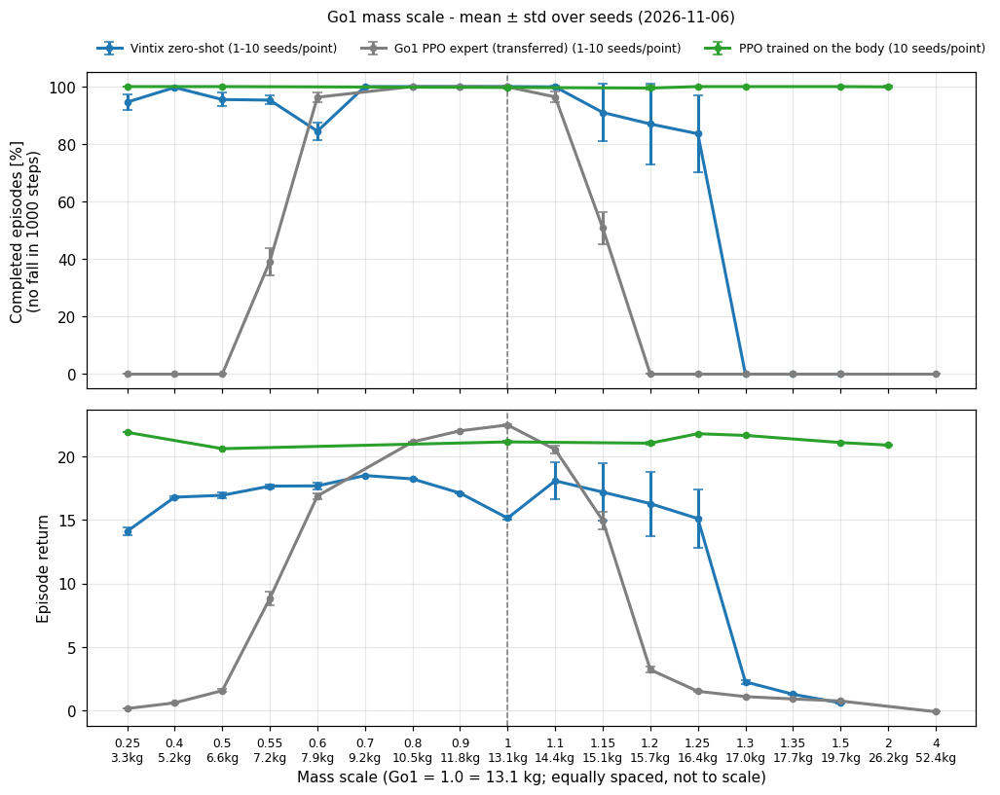
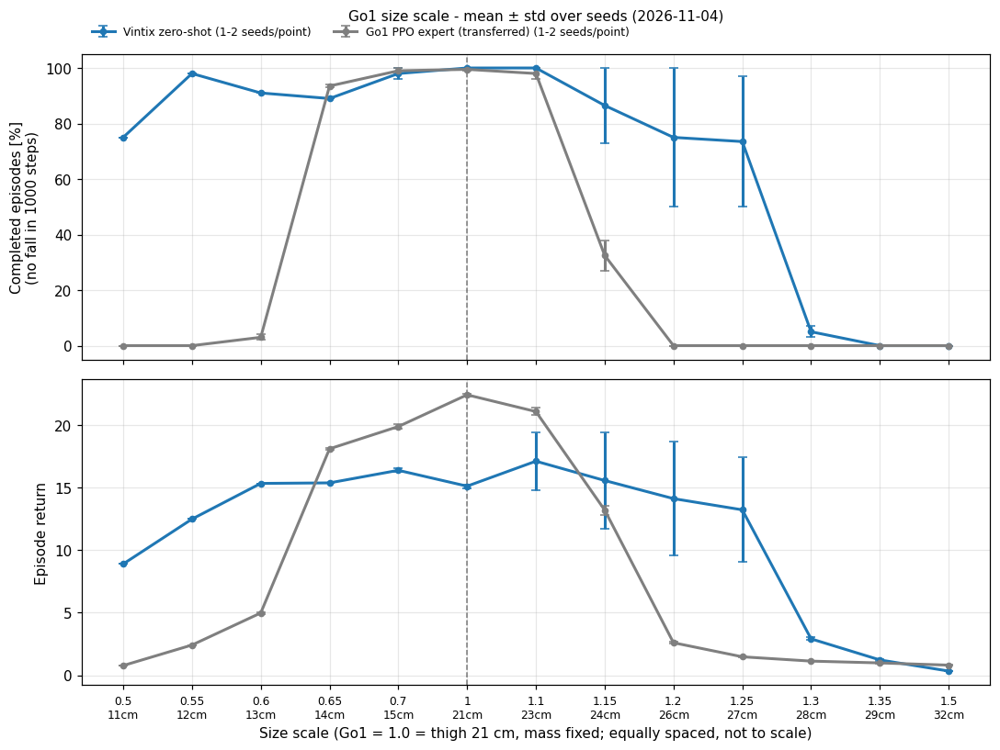
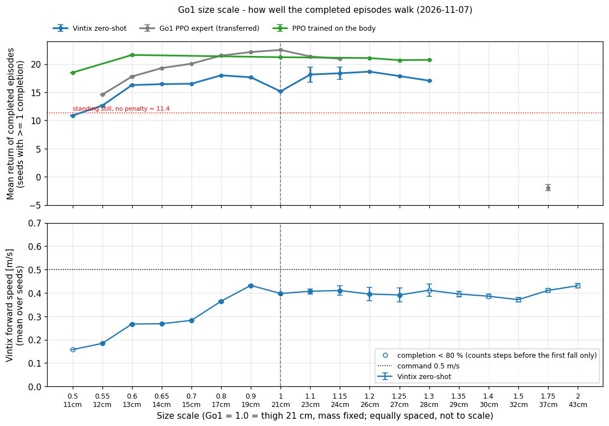
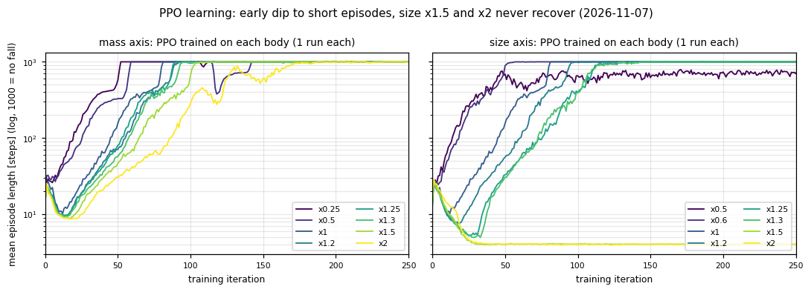
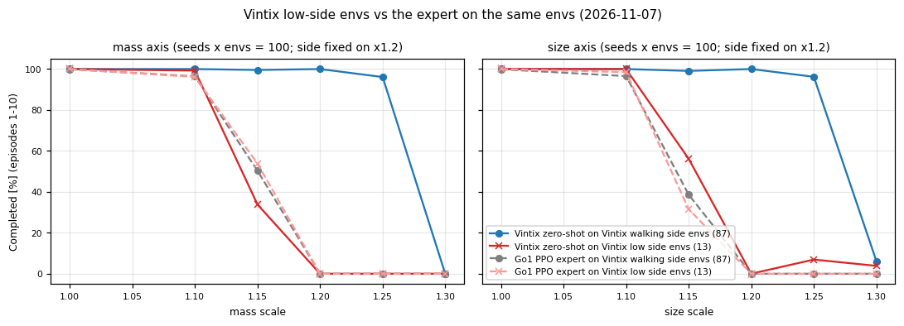
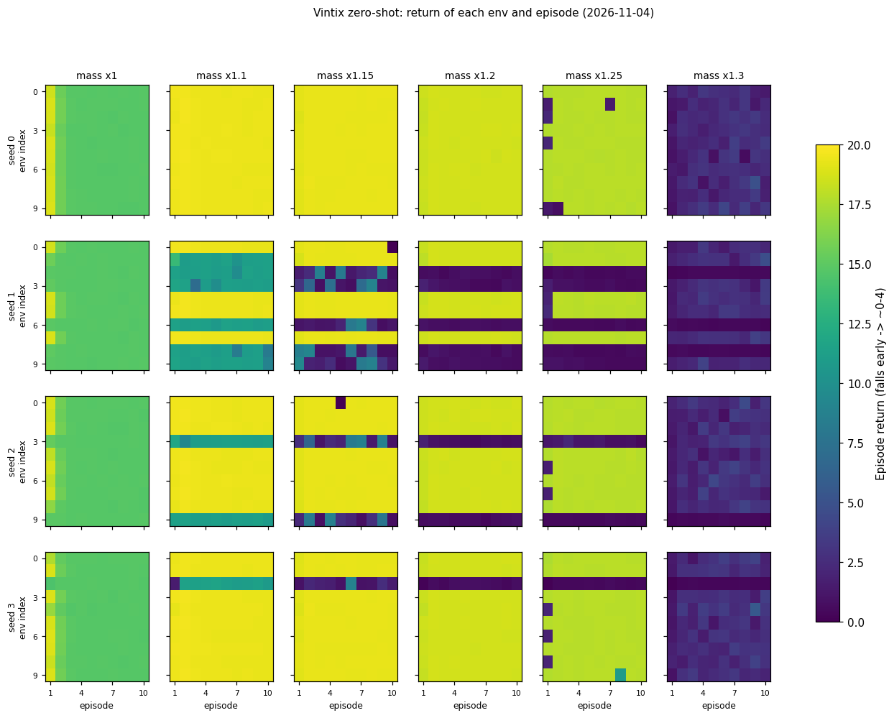
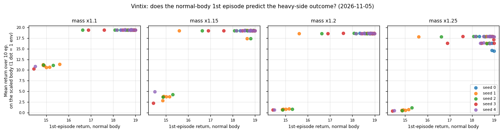
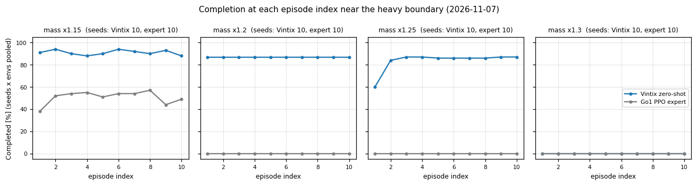

# Go1 質量・サイズ変化のゼロショット境界 — 実験レポート

> やったこと: Go1 の質量だけ／大きさだけを変えた改造 Go1（質量 21 点 × 大きさ 18 点）で、Vintix のゼロショットと流用した Go1 PPO 専門家を全点シード 0〜9（1 点 1000 エピソード）で評価。さらに 16 点で、その体でゼロから PPO を学習して「体そのものが歩けるか」を確認。自動実行は 2026-11-07 07:18 UTC に全段階完了
> これから: 判断待ち: 質量 × 大きさの同時変更（#7）、二極化の原因の切り分け（#8）、大きさ 1.5 倍以上の PPO の学習失敗の切り分け（#9）、専門家・PPO の前進速度をそろえる追加評価（#2）

---

### 概要

**Vintix がゼロショットで歩ける体の幅は、重い・大きい側は両軸とも 1.25 倍まで（1.3 倍で完走 0〜6%）、軽い側は質量 0.25 倍まで（完走 95%）。** 流用した専門家（1.1〜1.15 倍、軽い側は質量 0.6 倍まで）より両側に広い。10 シードで境界は動かない。
**どの崩れも体の限界ではない**: その体でゼロから学習した PPO は質量 0.25〜2.0 倍・大きさ 0.5〜1.3 倍のすべてで 99% 以上完走し、報酬も通常体並み（18.5〜21.9）。大きさ 1.5・2.0 倍は PPO の学習自体が失敗した（#9）。
ただし「転ばない」と「指令どおり歩ける」は別で、小さい体（大きさ 0.5〜0.8 倍）の Vintix は完走 74〜100% でも前進速度 0.16〜0.36 m/s（指令 0.5 m/s）。完走した本の報酬は同じ体の PPO の 0.59〜0.89 倍。
境界付近の Vintix は環境ごとに「ずっと歩ける側」と「低い側（専門家と同じ 1.15 倍から崩れる）」に分かれ、低い側は両軸とも 100 環境中 13 個。どちらに入るかは通常体の 1 本目の報酬でほぼ事前に分かる（事前予測は 450 個中 445 個一致）。

### 目的

どれくらい体が違うとアルゴリズム蒸留（Vintix）だけではうまく適応できないかを、「質量」「大きさ」に分けて数値で把握する（[#1](https://github.com/ishiishiishii/vintix/issues/1)、[#2](https://github.com/ishiishiishii/vintix/issues/2)）。

### 方法

- モデル: `models/go1_without/go1_without/0001_epoch`（Go1 を学習していない Vintix）を追加学習なしで使う。正規化は既知 3 タスク平均（ISCIIA と同じ）
- 比較: 通常の Go1 で学習した PPO 専門家 `model_2000.pt` を改造体にそのまま流用
- 体の限界の確認: 16 点（質量 0.25, 0.5, 1.0, 1.2, 1.25, 1.3, 1.5, 2.0 / 大きさ 0.5, 0.6, 1.0, 1.2, 1.25, 1.3, 1.5, 2.0）で、その体で PPO を 500 反復ゼロから学習（各 1 本、4096 環境）し、同じ評価を 10 シード
- 評価: 各点 シード 0〜9 × 10 環境 × 10 エピソード（最大 1000 step）。共通スクリプトは変更せず、実験ディレクトリ内の `ScaledGo1Env` で差し替え。`pipeline.py` で自動実行（境界付近 520 本 → PPO 176 本 → 残りの点 260 本）

### 実験内容・設定

| 項目 | 値 |
|------|-----|
| 質量軸 m | 全リンクの質量と慣性を m 倍。0.25, 0.4, 0.5, 0.55, 0.6, 0.7, 0.8, 0.9, 1.0, 1.1, 1.15, 1.2, 1.25, 1.3, 1.35, 1.5, 1.75, 2.0, 2.5, 3.0, 4.0（21 点） |
| 大きさ軸 s | 全寸法を s 倍、総質量は 13.1 kg に固定。0.5, 0.55, 0.6, 0.65, 0.7, 0.8, 0.9, 1.0, 1.1, 1.15, 1.2, 1.25, 1.3, 1.35, 1.4, 1.5, 1.75, 2.0（18 点） |
| 制御・トルク・指令 | Go1 のまま固定（kp=20, kd=0.5, 前進 0.5 m/s） |
| 指標 | 完走率（1000 step 転倒せずに終わったエピソードの割合）、Vintix の前進速度、完走した本の報酬と同じ体の PPO の報酬の比 |

### 結果

**倍率ごとのまとめ（境界の前後だけ抜粋。全点は `figures/summary_table_20261104.md`）**

完走率は 10 シード平均（カッコ内はシードごとの最小〜最大）。速度は Vintix だけ記録（専門家・PPO の評価スクリプトは報酬しか残さない）。

| 体 | Vintix 完走率 % | 専門家 完走率 % | その体の PPO 完走率 % | Vintix 前進速度 m/s | Vintix 完走本の報酬 / PPO |
|---|---:|---:|---:|---:|---:|
| 質量 0.25 倍 | 94.6（90〜98） | 0 | 100 | 0.58 | 14.8 / 21.9 = 0.67 |
| 質量 0.55 倍 | 95.3（92〜97） | 39.2（33〜48） | — | 0.45 | — |
| 通常体 1.0 倍 | 100 | 99.9 | 99.7 | 0.40 | 15.2 / 21.2 = 0.72 |
| 質量 1.15 倍 | 91.0（65〜100） | 50.8（42〜61） | — | 0.36 | — |
| 質量 1.25 倍 | 83.6（48〜97） | 0 | 100 | 0.32 | 17.9 / 21.8 = 0.82 |
| 質量 1.3 倍 | 0 | 0 | 100 | （転ぶ前 0.34） | 完走なし |
| 大きさ 0.5 倍 | 74.5（64〜80） | 0 | 100 | （転ぶ前 0.16） | 10.9 / 18.5 = 0.59 |
| 大きさ 0.6 倍 | 85.4（80〜91） | 4.3（2〜7） | 100 | 0.27 | 16.3 / 21.6 = 0.75 |
| 大きさ 0.8 倍 | 100 | 99.7 | — | 0.36 | — |
| 大きさ 1.15 倍 | 93.5（73〜100） | 37.7（27〜44） | — | 0.41 | — |
| 大きさ 1.25 倍 | 84.6（50〜97） | 0 | 100 | 0.39 | 17.9 / 20.7 = 0.86 |
| 大きさ 1.3 倍 | 5.8（2〜9） | 0 | 100 | （転ぶ前 0.41） | 17.1 / 20.7 = 0.82 |

それより外側は、質量 1.35〜4.0 倍・大きさ 1.35〜2.0 倍で Vintix・専門家とも完走 0〜6%（大きさ 1.75 倍の専門家の 6.3% は報酬 0 前後で歩いていない）、質量 0.7〜0.9 倍・大きさ 0.7〜0.9 倍は両方 99% 以上。
PPO は質量 0.25〜2.0 倍の 8 点・大きさ 0.5〜1.3 倍の 6 点で 99% 以上（報酬 18.5〜21.9）、大きさ 1.5・2.0 倍で 0%（学習の失敗、下記）。「—」は PPO を学習していない倍率。
速度は各環境の最初の転倒までしか数えないので、完走率 80% 未満の点（カッコ付き）は「転ぶ前の速さ」。

`figures/mass_completion_return_20261104.png`

`figures/size_completion_return_20261104.png`

**完走した本はどれだけ歩けているか**

`figures/size_walking_quality_20261104.png`（質量軸は `figures/mass_walking_quality_20261104.png`）

小さい体の Vintix は転ばないが遅い（大きさ 0.55 / 0.6 / 0.7 / 0.8 倍で 0.18 / 0.27 / 0.28 / 0.36 m/s、指令 ±15% 以内の時間 0 / 0.1 / 0 / 3.1%）。同じ体の PPO は大きさ 0.6 倍で報酬 21.6 なので、体の限界ではない。
報酬の閾値で「歩けた」を決めることはしない: 止まって立っているだけで報酬は最大 約 11.4 入り、通常体の Vintix も完走 1000 本中 825 本が 15 未満（2 本目以降は 14.8 に収束）。

**大きさ 1.5・2.0 倍では PPO の学習が失敗した**

どの体の学習も最初の 10〜40 反復で「すぐ倒れる」方向へ落ち込み（倒れても罰がなく、最初は 1 ステップごとの報酬が負なので早く終わるほど損が小さい）、そこから立ち直る。
落ち込みは体を大きくするほど深く長く（最小エピソード長 大きさ 1.0 倍 10.1 → 1.3 倍 4.9 ステップ）、1.5・2.0 倍は 500 反復まで 4 ステップのまま戻らなかった。
評価でも 1000 本すべてが開始 3〜5 ステップで自分から傾いて打ち切られる（同じ 1.5 倍で専門家・Vintix は中央値 約 80 ステップもつ）。学習の失敗 1 本ずつなので「歩けない体」とは言えない（#9）。

`figures/ppo_learning_curves_20261104.png`

**境界付近の Vintix は環境ごとに二極化する**

同じシードの中では、1.15〜1.25 倍のどれでも同じ環境が 10 本すべて転ぶ（または低い報酬で歩く）。低い側（1.2 倍で 2〜10 本目の平均報酬 < 15）に入った環境はシード 0〜9 で質量軸 0/5/2/1/1/1/0/2/1/0 個、大きさ軸 0/5/2/1/1/2/0/1/1/0 個（どちらも 100 個中 13 個）。
重い側の完走率のシード間のばらつき（1.2 倍で 50〜100%）は、ほぼこの数で決まる。
低い側の 13 個では Vintix は専門家と同じ 1.15 倍で崩れ（質量 1.15 倍で完走 33.8%、1.2 倍以上 0%）、「専門家より 1 刻み先」が成り立つのは 87 個（1.25 倍で 96%）。
専門家は同じ環境でも特に失敗せず（質量 1.15 倍で低い側の環境 53.8%、歩ける側の環境 50.3%）、その成否は同じ初期のずれを受けても両軸で偶然程度にしか一致しない（一致 57%、無相関なら 55%）。初期のずれで結果が環境ごとに固定されるのは Vintix 特有（専門家と Vintix で同じずれが入るかは未確認）。

`figures/vintix_side_vs_expert_20261104.png`

`figures/vintix_mass_env_modes_20261104.png`（大きさ軸は `figures/vintix_size_env_modes_20261104.png`）

低い側に入るのは、通常体（1.0 倍）の 1 本目の報酬が約 15 の環境（歩ける側は約 18.5）。シード 0〜2 を見て決めた閾値（1 本目 < 15.5）で、重い側の結果が出る前に予測を書き、
環境 × 倍率（1.15〜1.25 倍）で **450 個中 445 個**が当たった（大きさ軸シード 2〜9、質量軸シード 3〜9）。外れ 5 個はすべて 1 本目 15.15〜15.34 の環境で、この範囲では倍率や軸によって側が入れ替わる。

`figures/vintix_mass_first_episode_predictor_20261104.png`

**1.25 倍では歩ける側の環境も 1 本目だけ転ぶことがある**

1.25 倍では歩ける側の環境の約 3 割（質量 87 個中 27 個、大きさ 87 個中 23 個）が 1 本目だけ転び、2 本目からはほぼ完走する（完走率 1 本目 60〜63% → 2〜10 本目 86〜87%）。
両軸で同じ環境番号になるのは 10 個だけで、無作為の期待値（約 8.5 個）と同程度なので、低い側とは別の現象。1.3 倍では立て直せない。

`figures/mass_completion_by_episode_20261104.png`

### うまくいかなかったこと → 修正

- 第 1 段階は各点 1 回だけで、境界付近の値（例: 質量 1.2 倍で報酬 16.86 ± 5.26）が評価し直すたびに変わった → シード 0〜9 を固定して 10 回評価する第 2 段階に切り替えた
- 予測の照合を完走で数えると 1.15 倍で側を分けられなかった（低い側も報酬約 7 で完走することがある）→ 報酬（2〜10 本目の平均 < 15）で数えるよう統一した
- 当初 `go1_env.py` を直接編集した → 戻し、実験ディレクトリの `ScaledGo1Env` に閉じた
- 最初の PPO 学習が、並列の Vintix 評価 3 本と GPU メモリを取り合って落ちた（CUDA OOM）→ `pipeline.py --max_evals_with_train 0` で学習中は評価を走らせないようにして再起動した
- 「歩けた = 完走かつ報酬 15 以上」で数える予定だった → 止まって立つだけで約 11.4、通常体の Vintix でも大半が 15 未満になるのでやめ、完走率・前進速度・同じ体の PPO との報酬の比を並べた
- `--stage report` の `results.csv` は、専門家で早く転んだ環境が 10 本を超えて記録された分まで数えていた → 各環境の先頭 10 本に絞るよう `collect_rows` を修正（全点 1000 本にそろった。専門家の値の変化は報酬で最大 +0.41、完走率で最大 +2.1 ポイント。図と表は元から先頭 10 本）

### 考察・いま言えること

- **歩ける上限は Vintix が専門家より 1 刻み先（1.25〜1.3 倍 対 1.1〜1.15 倍）。10 シード両軸で動かない。** ただし質量 1.25 倍の速度は 0.32 m/s（指令の 6 割強、大きさ 1.25 倍は 0.39 m/s）で、完走だけで「適応できた」とは言えない
- **「どれくらい体が違うと適応できないか」への答え（この設定で）:** 重い・大きい側は 25〜30% 増、軽い側は質量 75% 減でも転ばない。ただし小さい側は大きさ 0.7 倍以下で速度が指令の 6 割未満（通常体でも 8 割）で、完走率は適応の幅を広く見せる。崩れる位置は体ではなく Vintix の汎化の幅で決まる（下記）
- **Vintix・専門家の崩れは、測った範囲ではどれも体の物理的な限界ではなく方策の限界。** その体で学習した PPO は質量 2.0 倍（26.2 kg）・大きさ 1.3 倍（太もも 28 cm）でも 99% 以上完走する。Vintix の 1.3 倍の全滅も、専門家の軽い・小さい側の崩れも、この範囲の内側。つまり「どれくらい体が違うとゼロショットで適応できないか」の答え（1.25〜1.3 倍）は、体ではなく Vintix の汎化の幅で決まっている
- 体を重く・大きくするほど PPO の学習の立ち上がりは遅れる（平均エピソード長 1000 到達 質量 0.25 倍 52 → 2.0 倍 189 反復）が、最終性能は同じ
- **Vintix の重い側の成績は「どちらの側に入るか」でほぼ決まる。** 低い側に入った環境は専門家と同じ 1.15 倍から崩れ、10 本の間に抜け出せない。側は通常体の 1 本目の報酬で事前にほぼ分かり、評価で環境ごとに入る乱数は 1 本目の初期のずれだけ（コードで確認）なので、1 本目の動きが文脈に残って歩き方を固定していると考えられる（推測）
- **軽い側は Vintix が明らかに広い**（質量 0.25 倍で 95%、専門家は 0.5 倍以下で 0%）。小さい側は転ばないだけで速度が足りない
- **質量と大きさで崩れる倍率がほぼ同じ。** ゲインとトルク上限が固定なので、姿勢を保つトルク（質量 × 脚の長さに比例）で決まっている可能性（未検証、#7）
- **まだ言えないこと:** 大きさ 1.5 倍以上が歩ける体かどうか（PPO の学習失敗 1 本ずつ、#9）。PPO は各倍率 1 本の学習なので学習の失敗率は分からない。1 本目の報酬が「なぜ」側を決めるか、1.25 倍の 1 本目だけの転倒が文脈内の適応か（どちらも #8 の対照が必要）。1 本目 15.15〜15.34 の環境が本当の境目なのか数値の偶然なのか

### 次の予定

- 本実験（#2）の評価はすべて完了。`main` への取り込み（PR、#2 の close）はユーザー確認後
- 判断待ち: 質量と大きさを同時に変える検証（#7、約 6 GPU 時間）、二極化の原因の切り分け（#8、約 10 GPU 時間）、大きさ 1.5 倍以上の PPO の学習失敗の切り分け（#9、まずシード違い 3 本 約 2.3 GPU 時間）
- 任意（#2 で打診中）: 専門家・PPO の前進速度もそろえる評価と、通常体の Vintix の報酬の谷（14.8）の項別記録（合わせて約 1 GPU 時間）

---

<strong>詳細</strong>

## 1. 概要

ISCIIA では未知ロボットのゼロショットで Go1 / A1 は歩け、Go2 / Mini Cheetah は転倒した。
本実験はその「境界」を、Go1 の体パラメータを連続的に動かして測る。第 1 段階で 60 点を 1 回ずつ粗く測り、
第 2 段階で境界付近 26 点をシード 0〜9 で測った（Issue: #1 目的、#2 刻み・10 シード・PPO、#3 設計の合意、#7・#8 は追加の検証案）。

## 2. 目的

- 質量軸・大きさ軸それぞれで、Vintix ゼロショットが崩れる倍率を数値で得る
- 流用した Go1 PPO 専門家との比較で、「履歴付き方策の方が広い範囲に効くか」を見る
- 成功／失敗の二値ではなく、倍率ごとの平均 ± ばらつきで報告する（Notion 合意）

## 3. 方法

実装はすべて `vintix_go2/go1_body_scale_zeroshot/` に閉じる。

| ファイル | 役割 |
|----------|------|
| `scaled_go1_env.py` | 共通 `Go1Env` を継承。URDF scale と `set_mass` で体を変える |
| `body_scale.py` | 倍率格子（`FULL_GRID` / `BOUNDARY_GRID` / `PPO_GRID`）と `cfgs.pkl` からの設定生成 |
| `run_experiment.py` | 1 点 1 サブプロセス。子内だけで `save_vintix.Go1Env` / `save_expert.Go1Env` を差し替え。PPO 学習ワーカーも持つ |
| `pipeline.py` | 第 2 段階の自動実行（再開可能、評価 4 本並列） |
| `make_figures.py` | `figures/` の図（完走率・二極化ヒートマップ・1 本目の散布図・エピソード番号ごとの完走率） |

共通の `go1_env.py` / `save_vintix.py` / `save_expert.py` は変更していない。

## 4. 実験設定（共通）と設計理由

- ベース cfg: `Genesis/logs/go1-walking/cfgs.pkl`（初期高さ 0.40 m、目標高さ 0.32 m）
- 質量: 全リンク同一倍率（重心位置不変）
- 大きさ: 質量固定（密度一定の相似拡大はやらない）。初期高さ・目標高さ・足上げ高さだけ s 倍
- 正規化: 未知タスク既定（既知タスク平均）。対象ロボットの軌跡統計は使わない
- シード: 評価前に python / numpy / torch / Genesis を固定。同じシードで結果が完全一致することを確認済み
- 評価の乱数: 環境ごとに入るのは開始時の初期のずれだけで、2 本目以降のリセットはずれなし、行動も決定的（`save_vintix.py` 350〜365 行、`go1_env.py` `reset_idx`）。
  このため各環境の 10 本は独立な試行ではなく、境界は「シード × 環境」（10 シードで 100 個）の単位で数える
- 専門家の評価は早く転倒した環境が 10 本を超えて記録されることがある（`save_expert.py`）。集計（`make_figures.py`、`run_experiment.py` の `collect_rows`）は各環境の先頭 10 本に絞った

## 5. 実験ログ

### 実験1: 共有コードへの直接パッチ（取り消し）

- 問題: 過去実験の再現性を損なう
- 対応: `go1_env.py` を git checkout で戻し、`ScaledGo1Env` に移した

### 実験2: 第 1 段階（60 点 × 1 回、シード未固定）

- 結果: Vintix は質量・大きさともおおむね 0.5〜1.2 倍で歩け、流用した専門家は 0.7〜1.1 倍程度で崩れた。重い・大きい側の上限はどちらも約 1.2 倍に見えた
- 問題: 各点 1 回だけで、境界付近の値の信頼性が分からない（例: 質量 1.2 倍の Vintix 16.86 ± 5.26）
- 数値: `results_single_run.csv`、図: `graphs/single_run/`

| 倍率 m | Vintix 報酬 | Expert 報酬 | 倍率 s | Vintix 報酬 | Expert 報酬 |
|--------|-------------|-------------|--------|-------------|-------------|
| 0.25 | 14.49 ± 1.90 | 0.14 ± 0.08 | 0.5 | 8.94 ± 3.60 | 0.73 ± 0.79 |
| 0.5 | 16.68 ± 2.42 | 1.66 ± 1.39 | 0.7 | 16.41 ± 0.97 | 19.87 ± 1.92 |
| 1.0 | 15.14 ± 1.04 | 22.28 ± 2.22 | 1.0 | 15.15 ± 1.07 | 22.51 ± 0.02 |
| 1.2 | 16.86 ± 5.26 | 2.97 ± 1.88 | 1.2 | 16.86 ± 5.38 | 2.70 ± 1.14 |
| 1.3 | 2.18 ± 0.84 | 1.14 ± 0.32 | 1.3 | 4.60 ± 5.84 | 1.16 ± 0.31 |

### 実験3: 第 2 段階の境界付近（26 点 × シード 0〜9）

- 変更点: 刻みを追加（質量 0.55, 1.15, 1.25, 1.35 / 大きさ 0.55, 0.65, 1.15, 1.25, 1.35）、シード 0〜9 で評価
- 結果: 冒頭の表のとおり。シード 0 の段階で「第 1 段階の両方約 1.2 倍」は刻みが粗かっただけで、専門家 1.15〜1.2 倍、Vintix 1.25〜1.3 倍と分かれた
- 新しく分かったこと: 境界付近の Vintix は環境ごとに二極化し、シードのぶれの正体はその環境の数。シード 3 以降は通常体の 1 本目から重い側の結果を事前に予測して照合した（経過は README の「実行ログ」）
- 残課題: 二極化の原因（#8）、上限が体の限界かどうか（PPO → 実験4）

### 実験4: その体でゼロから学習した PPO（16 点 × 学習 1 本 × 評価シード 0〜9）

- 方法: `run_experiment.py --worker train_ppo`（共通 `train.py` の学習を `ScaledGo1Env` で呼ぶ）。500 反復、4096 環境、1 本 約 35 分（GPU 単独）。出力 `ppo/<axis>/s<倍率>/`
- 事前予測: 質量 1.25・1.3 倍と大きさ軸（1.0〜1.5 倍、0.6 倍）は学習の開始前・評価の前に README に書いてコミット（1555114、19fa8b1）。1.5 倍（大きさ）の「90% 以上」以外は当たった
- 結果（完走率・報酬）:

| 倍率 | 質量軸 PPO | 大きさ軸 PPO |
|------|-----------|-------------|
| 0.25 | 100%、21.90 | — |
| 0.5 | 100%、20.62 | 100%、18.48 |
| 0.6 | — | 100%、21.61 |
| 1.0 | 99.7%、21.15 | 99.7%、21.15 |
| 1.2 | 99.5%、21.05 | 99.0%、20.85 |
| 1.25 | 100%、21.80 | 100%、20.69 |
| 1.3 | 100%、21.66 | 100%、20.75 |
| 1.5 | 100%、21.10 | **0%、−0.02（学習失敗）** |
| 2.0 | 99.9%、20.90 | **0%、−0.07（学習失敗）** |

- 学習の立ち上がり（平均エピソード長が初めて 1000 に達した反復）: 質量 0.25 / 0.5 / 1.0 / 1.5 / 2.0 倍 = 52 / 59 / 82 / 114 / 189、大きさ 0.6 / 1.0 / 1.2 / 1.25 / 1.3 倍 = 57 / 82 / 102 / 136 / 131。大きさ 0.5 倍は学習中 1000 に届かず約 885 で頭打ち（評価は決定的な行動で 100% 完走）
- 転倒の時刻: PPO の転倒はほぼすべて 1 本目の開始直後（質量 1.2 倍は 25〜60 ステップ、大きさ 1.2 倍は 9〜11 ステップ）。2〜10 本目はほぼ全数完走
- 大きさ 1.5・2.0 倍の失敗: 1 反復目の 1 ステップあたり報酬は大きさ 1.0 / 1.3 / 1.5 倍 = −0.010 / −0.025 / −0.034。1.5 倍の罰の大半は高さの誤差と上下方向の速度で、高い開始位置（0.60 m）からゼロ行動で立てる高さ（約 0.45 m）まで落ちる間の罰と考えられる（推測）

### 実験5: 残りの点（13 点 × 2 方策 × シード 0〜9）

- 対象: 境界付近に入っていなかった質量 0.7, 0.8, 0.9, 1.75, 2.0, 2.5, 3.0, 4.0 / 大きさ 0.8, 0.9, 1.4, 1.75, 2.0 倍（Vintix・専門家）（260 本、2026-11-06 18:35 〜 11-07 07:18 UTC、失敗 0）
- 結果: シード 0 だけで見ていた傾向と同じ。質量 0.7〜0.9・大きさ 0.8〜0.9 倍は両方 99.7% 以上、質量 1.75〜4.0・大きさ 1.4〜2.0 倍は Vintix 0%、専門家 0〜6.3%（大きさ 1.75 倍の専門家の「完走」は報酬 0 前後で、傾かずにもっただけ）
- Vintix の 2〜10 本目の報酬は体ごとにシードによらず同じ値に収束する（質量 0.7 / 0.8 / 0.9 / 1.0 倍 = 18.4 / 18.2 / 17.0 / 14.8）。2 本目以降は初期のずれが無く行動も決定的なためで、シードを増やしても独立な標本は増えない。通常体だけ報酬が低い谷になる理由は未調査（報酬の項別の記録が無い）
- 集計の修正: `collect_rows` を各環境の先頭 10 本に絞り、`--stage report` で再集計（全 94 点が 1 点 1000 本）

## 6. 結果まとめ

- 全点の表: `figures/summary_table_20261104.md`（3 方策の完走率、Vintix 前進速度、PPO との報酬の比）
- 歩ける上限（10 シード両軸で不変）: Vintix 1.25〜1.3 倍、専門家 1.1〜1.15 倍
- 軽い側: Vintix は質量 0.25 倍まで 95% 完走（専門家は 0.55 倍で 39%、0.5 倍以下 0%）
- 小さい側: Vintix は 0.5 倍で 76%、0.55〜0.7 倍で 85〜99% だが速度 0.16〜0.28 m/s。専門家は 0.6 倍以下で 0〜4%
- 低い側に入る環境: 両軸とも 100 個中 13 個。事前予測 450 個中 445 個一致（外れは 1 本目 15.15〜15.34 だけ）
- 1.25 倍で 1 本目だけ転ぶ環境: 質量 27/87、大きさ 23/87、両軸共通 10 個（期待値 約 8.5）
- その体で学習した PPO: 質量 0.25〜2.0 倍の 8 点と大きさ 0.5〜1.3 倍の 6 点で 99% 以上完走（報酬 18.5〜21.9）。大きさ 1.5・2.0 倍は学習失敗で 0%
- 全数値: `results.csv`（シード付き）、`results_single_run.csv`（第 1 段階）

## 7. 考察

- 上限の差（1 刻み）は小さいが 10 シードで一貫している。Vintix の上限の先の 1.3 倍の崩れは、その体で学習した PPO が 100% 歩けるので体の限界ではなく方策の限界
- PPO は各倍率 1 本の学習なので、「歩ける体である」ことの証明にはなるが、失敗した 1 本（大きさ 1.5・2.0 倍）は「歩けない体」の証明にならない。学習の「すぐ倒れる」局所解は体を大きくするほど深くなるので、開始高さ・報酬・シードを変えた再学習で切り分ける（#9）
- #7 のゼロ行動プローブ（質量 1.3 倍で 10 環境中 4 転倒）は、学習した方策なら補える。#7 の「質量 × 脚の長さ」仮説は体の限界ではなく「通常体で得た方策が補える範囲」の仮説として読むべき
- 重い側の Vintix の平均値は「低い側の環境の数」の揺れで動くので、シード平均 ± 標準偏差だけで比べると誤解しやすい。環境単位の割合で報告する
- 低い側を決めるのが初期状態そのものか文脈の始まり方かは、#8 の対照（初期のずれの記録、文脈を切った評価、1 本目もずれなし）で確かめる必要がある
- 第 1 段階の「質量 1.0 倍で 1 本目 17.9 → 終盤 14.8」も同じ現象の一部で、通常体でも 1 本目の高い報酬は 2 本目から約 14.8 にそろう

## 8. 今後の予定

1. 本実験の評価は完了（2026-11-07 07:18 UTC）。PR → `main`、#2 の close はユーザー確認後
2. 判断待ち: #7（質量 × 大きさ）、#8（二極化の原因）、#9（大きさ 1.5 倍以上の PPO の学習失敗の切り分け）
3. 任意（#2 で打診中）: 専門家・PPO の前進速度の記録、通常体の Vintix の谷の項別記録（約 1 GPU 時間）

## 9. 成果物パス

| 種類 | パス |
|------|------|
| 集計 | `results.csv`, `summary.json`, `results_single_run.csv` |
| 図 | `figures/*.png`（第 2 段階）、`graphs/`（`--stage report` の自動図）、`graphs/single_run/`（第 1 段階） |
| 各点 | `results/<policy>/<axis>/s<倍率>_seed<シード>/` |
| プローブ | `results/probe/` |
| 進捗・ログ | `pipeline_status.json`, `logs/pipeline.log`, `logs/` |

---
Notion: https://app.notion.com/p/40cd65e6123f81b3be04fe61479b7c70
